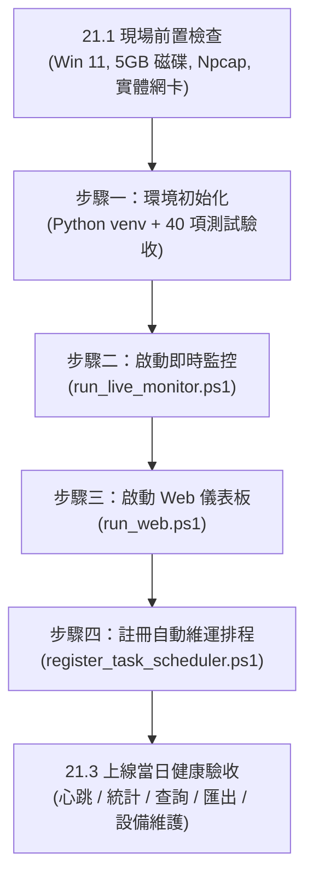

# DHCP Analyzer 資料庫與效能優化系統開發規格書

**文件版本：** V2.2  
**系統名稱：** DHCP Packet & Log Analyzer  
**執行平台：** Windows 11 64-bit  
**開發語言：** Python 3.10+  
**後端框架：** FastAPI  
**資料庫：** SQLite 3（WAL Mode）  
**封包擷取：** Scapy + Npcap  
**前端：** 獨立 Web UI  
**文件目的：** 作為系統實作、模組分工、測試及驗收依據。

---

# 第一章、專案目標與核心設計原則

## 1.1 專案目標

本系統為校園及企業內部網路 DHCP 封包與紀錄分析工具，整合離線封包分析、即時 DHCP 監控、異常偵測、設備清冊及網頁查詢功能。

系統必須支援：

1. 離線分析 PCAP、PCAPNG 及 CSV 檔案。
2. 網頁上傳 PCAP／PCAPNG／CSV，建立分析工作並查詢處理進度。
3. 背景常駐即時監控，透過 Scapy 擷取 DHCP 封包。
4. 單次分析超過 1,000,000 筆 DHCP 事件，不得將整份檔案載入記憶體。
5. 即時監控與離線分析共用 Parser、事件資料模型及異常判定規則。
6. SQLite 單一資料庫，離線分析與每次即時監控均使用獨立 `job_id`。
7. 預設啟用靜音封包精簡模式，降低常規事件明細寫入量。
8. 自動偵測 Rogue DHCP、DHCP Flooding／Starvation、IP Conflict 及異常租期。
9. 事件明細保存 30 天，設備資產與分析統計長期保存。
10. 網頁提供即時狀態、異常事件、設備清冊、分析歷史及統計儀表板。

## 1.2 核心設計原則

### 原則一：即時監控與網頁控制完全解耦

網頁不得啟動、停止或重啟 `dhcp_monitor.py`。

即時監控程序的啟停由 Windows 主機管理者透過命令列或作業系統程序管理方式執行。

網頁僅能讀取即時監控狀態及分析結果。

### 原則二：允許網頁提交離線分析工作

因系統需要支援網頁上傳及啟動分析，因此 FastAPI 不採取所有端點均為 SELECT 的限制，而是分為：

- 查詢 API：只允許查詢。
- 離線分析提交 API：允許接收檔案、建立工作及加入佇列。
- 監控控制 API：不提供。
- Worker：負責實際分析，不由 HTTP 請求執行解析。

網頁不得透過 API 操作即時監控程序。

### 原則三：統一解析核心

離線 PCAP、PCAPNG、CSV 與即時監控均使用共用的 DHCP Parser。

不得因資料來源不同而各自維護一套 DHCP Option 解析邏輯。

至少保留既有解析相容性：

- Option 12：Host Name
- Option 50：Requested IP
- Option 51：IP Address Lease Time
- Option 54：Server Identifier
- Option 81：Client FQDN

既有程式中其他已支援的 DHCP Option 也應保留，不得在重構時無故刪除。

### 原則四：串流解析與批次寫入

- PCAP／PCAPNG 使用串流方式讀取。
- CSV 使用逐列讀取方式。
- 禁止使用整檔 `read()` 將大型檔案載入記憶體。
- 事件明細以 BatchWriter 批次處理。
- 統計摘要每 5 秒持久化。
- 單次分析目標至少支援 1,000,000 筆事件。

### 原則五：資料庫寫入優先權

寫入優先級：

1. 即時監控事件、心跳及統計。
2. 離線分析事件與統計。
3. 資料清理、維護及低優先權更新。

SQLite 同一時間只有一個寫入交易，因此必須透過寫入協調器及短交易實現優先權，不得假設 WAL 可以提供多筆同時寫入。

---

# 第二章、系統整體架構

## 2.1 系統模組

系統分為六個主要模組。

| 模組 | 程式／目錄 | 主要責任 |
|---|---|---|
| 即時監控 | `dhcp_monitor.py` | 擷取 DHCP 封包、終端機輸出、即時分析 |
| 離線分析 | `analysis_worker.py` | PCAP／PCAPNG／CSV 串流解析 |
| 寫入協調 | `db_writer.py` | 統一管理 SQLite 寫入與優先權 |
| Web API | `api/` | 上傳檔案、建立工作、查詢資料 |
| 前端 | `frontend/` | 儀表板、事件清冊、設備清冊 |
| 資料維護 | `retention_worker.py` | 30 天清理、備份及資料庫維護 |

## 2.2 系統架構

```text
                         Windows 11 主機
┌───────────────────────────────────────────────────────────┐
│                                                           │
│  ┌──────────────────────┐                                 │
│  │ 即時監控程序          │                                 │
│  │ dhcp_monitor.py      │                                 │
│  │                      │                                 │
│  │ Scapy + Npcap        │                                 │
│  │ DHCP Parser          │                                 │
│  │ Anomaly Engine       │                                 │
│  │ Silent Filter        │                                 │
│  │ Console Output       │                                 │
│  └──────────┬───────────┘                                 │
│             │ 高優先權寫入                                 │
│             ▼                                             │
│  ┌──────────────────────┐                                 │
│  │ DB Writer            │                                 │
│  │ db_writer.py         │                                 │
│  │                      │                                 │
│  │ Priority Queue       │                                 │
│  │ BatchWriter          │                                 │
│  │ Retry / Backoff      │                                 │
│  └──────────┬───────────┘                                 │
│             │                                             │
│  ┌──────────┴───────────┐                                 │
│  │ SQLite WAL           │                                 │
│  │ dhcp_analyzer.db     │                                 │
│  └──────────▲───────────┘                                 │
│             │                                             │
│  ┌──────────┴───────────┐                                 │
│  │ FastAPI              │                                 │
│  │                      │                                 │
│  │ Upload API           │◄────── 獨立 Web UI              │
│  │ Analysis Job API     │                                 │
│  │ Read-only Query API  │                                 │
│  └──────────┬───────────┘                                 │
│             │                                             │
│             ▼                                             │
│  ┌──────────────────────┐                                 │
│  │ analysis_worker.py   │                                 │
│  │                      │                                 │
│  │ PCAP / PCAPNG        │                                 │
│  │ CSV Streaming        │                                 │
│  │ Shared Parser        │                                 │
│  │ Shared Anomaly Engine│                                 │
│  └──────────┬───────────┘                                 │
│             │ 一般優先權寫入                               │
│             └──────────────► DB Writer                    │
│                                                           │
│  ┌──────────────────────┐                                 │
│  │ retention_worker.py  │                                 │
│  │ 低優先權維護與清理    │                                 │
│  └──────────────────────┘                                 │
└───────────────────────────────────────────────────────────┘
```

## 2.3 程序間寫入協調

為確保即時監控優先，所有資料庫寫入必須經過 `db_writer.py`。

建議採用獨立 Writer Process，使用 Windows Named Pipe 或其他僅限本機的 IPC 機制傳遞寫入工作。

要求：

1. Writer Process 為主要資料庫寫入入口。
2. 即時監控寫入工作使用 HIGH 優先級。
3. 離線分析寫入工作使用 NORMAL 優先級。
4. 清理及維護工作使用 LOW 優先級。
5. Writer 內部統一建立 SQLite Connection。
6. 每次交易應盡量短，不得長時間持有寫入鎖。
7. 每筆寫入工作應有成功／失敗回覆。
8. 寫入失敗時須記錄錯誤及執行有限次重試。
9. 高優先權工作不得因低優先權批次長時間等待。
10. 必須避免低優先權工作被永久餓死，可採用優先權老化或適當排程。

Writer Process 若異常退出，其他程序不得假設資料已成功寫入。必須提供重新連線、錯誤回報及未完成批次處理策略。

---

# 第三章、Windows 11 執行環境

## 3.1 基本環境與相依性安裝標準

| 項目 | 規格 |
|---|---|
| 作業系統 | Windows 11 64-bit |
| Python | 3.10 以上（建議 3.12） |
| 相依性定義 | `requirements.txt` 與 `pyproject.toml` |
| 封包擷取 | Scapy |
| 封包驅動 | Npcap |
| Web Backend | FastAPI |
| ASGI Server | Uvicorn |
| Database | SQLite 3 |
| 前端 | 獨立 HTML／JavaScript 或既定前端框架 |

### 環境建置與相依性安裝原則

本專案之版本控制與多主機遷移，**以原生 Python 工具環境（`venv` + `pip`）及標準相依清單（`requirements.txt` / `pyproject.toml`）為官方標準**：

1. **標準 Python 虛擬環境建立（主流標準）**：
   ```cmd
   # 1. 建立虛擬環境
   python -m venv .venv

   # 2. 啟動環境 (PowerShell: .\.venv\Scripts\Activate.ps1 / CMD: .venv\Scripts\activate.bat)
   .\.venv\Scripts\activate

   # 3. 升級 pip 並安裝專案相依性
   python -m pip install --upgrade pip
   pip install -r requirements.txt
   # 或透過 pyproject.toml 進行開發測試套件安裝：
   pip install -e ".[dev]"
   ```
2. **依賴管理與版本控制原則**：
   - 專案相依套件與版本區間由 `requirements.txt` 及 `pyproject.toml` 作為權威依據。
   - 本地輔助工具之特定鎖定檔（如 `uv.lock`）均列入 `.gitignore`，**不上傳至 GitHub 倉儲**，確保其他開發人員或新部署主機具備最高度的原生 Python 相容性，不受特定第三方套件工具限制。
   - 本地開發者若習慣使用 `uv` 進行秒級加速（如 `uv sync --dev`），可作為本機輔助工具使用，但交付與遷移規格一律保證原生 `pip` 順暢安裝。

## 3.2 Npcap 與網卡設定

即時監控使用 Scapy 搭配 Npcap。

部署時必須：

1. 安裝適用版本的 Npcap。
2. 確認 Npcap 已能正常擷取指定網卡。
3. 確認 Windows 主機具有必要的封包擷取權限。
4. 支援列出可用網卡及網卡名稱。
5. 允許透過設定檔指定監聽網卡。
6. 啟動時檢查網卡是否存在。
7. 網卡不存在或無法擷取時，寫入錯誤狀態並停止進入正常監控狀態。

BPF Filter：

```python
filter="udp and (port 67 or port 68)"
```

使用 `store=False`，避免 Scapy 在記憶體中累積所有封包。

## 3.3 Windows 程序生命週期

即時監控必須支援：

- 正常啟動。
- 正常 Ctrl+C 停止。
- 程序異常終止偵測。
- 下一次啟動時檢查前一次未結束工作。
- 正常停止前完成統計與事件 Flush。
- 關閉 Writer 連線前完成待處理寫入。

不得只依賴 `atexit` 處理關閉流程，因為強制終止程序時不保證會執行。

---

# 第四章、資料庫規格

資料庫固定路徑：

```text
data/dhcp_analyzer.db
```

## 4.1 SQLite 設定

```sql
PRAGMA journal_mode = WAL;
PRAGMA synchronous = NORMAL;
PRAGMA foreign_keys = ON;
PRAGMA busy_timeout = 10000;
PRAGMA cache_size = -32768;
PRAGMA temp_store = MEMORY;
```

說明：

- `WAL`：允許讀取與寫入較有效率地並存。
- `synchronous=NORMAL`：在效能與資料安全間取得平衡。
- `foreign_keys=ON`：啟用外鍵約束。
- `busy_timeout=10000`：等待資料庫鎖定最長 10 秒。
- `cache_size=-32768`：配置約 32MB SQLite 頁面快取。
- `temp_store=MEMORY`：暫存資料優先使用記憶體。

注意：上述設定不能取代寫入協調器，也不能保證作業系統突然斷電時所有尚未提交的資料都能保留。

## 4.2 資料表總覽

| 資料表 | 用途 | 保存政策 |
|---|---|---|
| `system_status` | 系統與監控程序狀態 | 長期 |
| `analysis_jobs` | 分析工作紀錄 | 長期 |
| `dhcp_events` | DHCP 事件明細 | 30 天 |
| `devices` | 長期設備資產 | 長期 |
| `job_device_mappings` | 工作設備快照 | 長期或依工作保存政策 |
| `analysis_stats` | 分析統計 | 長期 |
| `analysis_sources` | 上傳檔案與來源資訊 | 依檔案保存政策 |

## 4.3 system_status

用途：記錄系統、Writer 及即時監控程序的狀態。

```sql
CREATE TABLE system_status (
    key TEXT PRIMARY KEY,
    value TEXT NOT NULL,
    updated_at TEXT NOT NULL
);
```

建議使用下列 Key：

- `monitor_status`
- `monitor_instance_id`
- `monitor_job_id`
- `monitor_pid`
- `monitor_heartbeat`
- `writer_status`
- `writer_heartbeat`
- `api_status`

狀態值：

```text
starting
running
stopping
offline
error
```

監控程序每 5 秒更新一次心跳。

前端每 4 秒查詢一次狀態。

判斷規則：

- 最後心跳距今小於 15 秒：顯示運作中。
- 最後心跳距今超過 15 秒：顯示離線或心跳逾時。
- 若資料庫無法查詢：顯示狀態未知，不得直接顯示為正常。

時間統一採 UTC ISO 8601 格式，前端轉換為台灣時間顯示。

## 4.4 analysis_jobs

用途：管理離線分析及每次即時監控工作。

```sql
CREATE TABLE analysis_jobs (
    job_id TEXT PRIMARY KEY,
    source_type TEXT NOT NULL,
    source_name TEXT NOT NULL,
    source_path TEXT,
    source_size INTEGER DEFAULT 0,
    source_hash TEXT,

    status TEXT NOT NULL,
    progress INTEGER DEFAULT 0,

    processed_packets INTEGER DEFAULT 0,
    total_events INTEGER DEFAULT 0,

    discover_count INTEGER DEFAULT 0,
    offer_count INTEGER DEFAULT 0,
    request_count INTEGER DEFAULT 0,
    ack_count INTEGER DEFAULT 0,
    nak_count INTEGER DEFAULT 0,
    decline_count INTEGER DEFAULT 0,
    inform_count INTEGER DEFAULT 0,

    rogue_server_count INTEGER DEFAULT 0,
    anomaly_count INTEGER DEFAULT 0,

    authorized_servers TEXT,
    target_naks TEXT,

    created_at TEXT NOT NULL,
    started_at TEXT,
    last_progress_at TEXT,
    completed_at TEXT,

    error_message TEXT,
    cancel_reason TEXT,
    worker_id TEXT,
    monitor_instance_id TEXT
);
```

`source_type`：

```text
pcap
pcapng
csv
live_monitor
```

`status`：

```text
queued
running
completed
failed
interrupted
cancelled
```

工作規則：

1. 每次啟動即時監控建立新 `job_id`。
2. 每次離線分析建立新 `job_id`。
3. 同一來源檔案可以重複分析。
4. 不得以來源檔案名稱作為唯一識別。
5. Worker 必須更新進度及最後進度時間。
6. 程序異常終止後，應由啟動復原流程檢查未完成工作。
7. 不得直接將所有 `running` 工作自動重新執行，必須先確認工作狀態及是否允許安全重跑。

索引：

```sql
CREATE INDEX idx_jobs_status
ON analysis_jobs(status);

CREATE INDEX idx_jobs_created
ON analysis_jobs(created_at DESC);

CREATE INDEX idx_jobs_source_hash
ON analysis_jobs(source_hash);
```

## 4.5 dhcp_events

用途：保存高價值 DHCP 事件、異常事件及設備變更事件。

```sql
CREATE TABLE dhcp_events (
    id INTEGER PRIMARY KEY AUTOINCREMENT,

    job_id TEXT NOT NULL,
    event_time TEXT NOT NULL,
    created_at TEXT NOT NULL,

    message_type TEXT NOT NULL,

    transaction_id INTEGER,

    source_ip TEXT,
    source_mac TEXT,

    client_ip TEXT,
    client_mac TEXT NOT NULL,

    server_ip TEXT,
    server_mac TEXT,

    requested_ip TEXT,
    assigned_ip TEXT,

    relay_ip TEXT,
    hostname TEXT,
    client_fqdn TEXT,

    lease_time INTEGER,

    vlan_id INTEGER,
    interface_name TEXT,
    source_packet_no INTEGER,

    is_rogue INTEGER DEFAULT 0,
    anomaly_type TEXT DEFAULT 'NONE',
    severity TEXT DEFAULT 'INFO',

    matched_watch INTEGER DEFAULT 0,

    FOREIGN KEY(job_id)
        REFERENCES analysis_jobs(job_id)
        ON DELETE CASCADE
);
```

`message_type`：

```text
DISCOVER
OFFER
REQUEST
DECLINE
ACK
NAK
INFORM
RELEASE
UNKNOWN
```

`anomaly_type`：

```text
NONE
FLOODING
DECLINE_DETECTED
POSSIBLE_IP_CONFLICT
CONFIRMED_IP_CONFLICT
ABNORMAL_LEASE
ROGUE_DHCP
```

`severity`：

```text
INFO
WARNING
HIGH
CRITICAL
```

必要索引：

```sql
CREATE INDEX idx_events_job_time
ON dhcp_events(job_id, event_time DESC, id DESC);

CREATE INDEX idx_events_job_type_time
ON dhcp_events(job_id, message_type, event_time DESC, id DESC);

CREATE INDEX idx_events_anomaly
ON dhcp_events(anomaly_type, event_time DESC);

CREATE INDEX idx_events_rogue
ON dhcp_events(is_rogue, event_time DESC);

CREATE INDEX idx_events_mac
ON dhcp_events(client_mac);

CREATE INDEX idx_events_ip
ON dhcp_events(assigned_ip);

CREATE INDEX idx_events_created
ON dhcp_events(created_at);
```

注意：

- 不保存完整封包 bytes。
- `source_packet_no` 用於追溯原始 PCAP 封包位置。
- 原始檔案保留在檔案系統。
- 若 CSV 沒有封包序號，該欄位允許為 NULL。
- 封包欄位無法取得時允許 NULL，不得自行推測。

## 4.6 devices

用途：長期設備資產主表。

```sql
CREATE TABLE devices (
    device_id INTEGER PRIMARY KEY AUTOINCREMENT,

    mac TEXT NOT NULL UNIQUE,

    hostname TEXT,
    hostname_updated_at TEXT,

    last_ip TEXT,
    last_ip_updated_at TEXT,

    device_name TEXT,
    location TEXT,

    verification_status TEXT DEFAULT 'unverified',

    first_seen TEXT NOT NULL,
    last_seen TEXT NOT NULL,

    last_source_type TEXT,

    created_at TEXT NOT NULL,
    updated_at TEXT NOT NULL
);
```

設備欄位更新規則：

1. `device_name`、`location` 為人工欄位，不得被 DHCP 自動更新覆蓋。
2. `hostname`、`last_ip` 為自動偵測欄位。
3. 每次取得新資訊時更新對應時間。
4. 不得因單一封包資料不完整而將原本有效欄位清空。
5. 同一 MAC 的設備紀錄必須保持唯一。
6. MAC 儲存前統一正規化格式。

`verification_status`：

```text
unverified
verified
suspicious
```

## 4.7 job_device_mappings

用途：保存單次工作內的設備快照。

```sql
CREATE TABLE job_device_mappings (
    id INTEGER PRIMARY KEY AUTOINCREMENT,

    job_id TEXT NOT NULL,
    mac TEXT NOT NULL,

    hostname TEXT,
    ip TEXT,

    first_seen TEXT NOT NULL,
    last_seen TEXT NOT NULL,

    FOREIGN KEY(job_id)
        REFERENCES analysis_jobs(job_id)
        ON DELETE CASCADE,

    UNIQUE(job_id, mac)
);
```

索引：

```sql
CREATE INDEX idx_mapping_job_mac
ON job_device_mappings(job_id, mac);
```

用途：

- 查詢單次分析發現哪些設備。
- 比較不同分析工作中的設備變化。
- 不因設備主表更新而改變歷史工作快照。

## 4.8 analysis_stats

用途：保存每個工作統計摘要。

```sql
CREATE TABLE analysis_stats (
    job_id TEXT PRIMARY KEY,

    total_packets INTEGER DEFAULT 0,
    total_events INTEGER DEFAULT 0,

    discover_count INTEGER DEFAULT 0,
    offer_count INTEGER DEFAULT 0,
    request_count INTEGER DEFAULT 0,
    ack_count INTEGER DEFAULT 0,
    nak_count INTEGER DEFAULT 0,
    decline_count INTEGER DEFAULT 0,
    inform_count INTEGER DEFAULT 0,

    silent_count INTEGER DEFAULT 0,
    rogue_server_count INTEGER DEFAULT 0,

    anomaly_flood_count INTEGER DEFAULT 0,
    anomaly_conflict_count INTEGER DEFAULT 0,
    anomaly_lease_count INTEGER DEFAULT 0,

    unique_device_count INTEGER DEFAULT 0,

    write_failed_count INTEGER DEFAULT 0,

    updated_at TEXT NOT NULL,

    FOREIGN KEY(job_id)
        REFERENCES analysis_jobs(job_id)
        ON DELETE CASCADE
);
```

每 5 秒更新一次統計。

統計更新必須採用累加或明確的快照更新方式，不得因重試而重複累加同一批資料。

## 4.9 analysis_sources

用途：保存上傳檔案及來源資訊。

```sql
CREATE TABLE analysis_sources (
    source_id TEXT PRIMARY KEY,

    job_id TEXT NOT NULL,

    original_filename TEXT NOT NULL,
    stored_filename TEXT NOT NULL,
    stored_path TEXT NOT NULL,

    file_size INTEGER NOT NULL,
    file_hash TEXT,

    source_type TEXT NOT NULL,

    upload_status TEXT NOT NULL,

    created_at TEXT NOT NULL,

    FOREIGN KEY(job_id)
        REFERENCES analysis_jobs(job_id)
        ON DELETE CASCADE
);
```

上傳狀態：

```text
uploading
uploaded
queued
processing
completed
failed
```

檔案儲存路徑不得直接使用使用者傳入的路徑或檔名。

---

# 第五章、資料夾、檔案架構與系統執行架構

## 5.1 專案目錄與實際檔案結構

專案目錄以實作生產環境結構為準：

```text
Monitor/
│
├── app.py                      # FastAPI Web 主程式，掛載前端路由與 V2 API
├── api_v2.py                   # V2 RESTful API 端點（查詢、上傳、時間窗匯出、設備維護）
├── dhcp_monitor.py             # Scapy + Npcap 背景即時封包監控程序（含 Console 彩色輸出）
├── db_writer.py                # 單一 SQLite 寫入協調器（HIGH/NORMAL/LOW 優先權隊列、短交易、重試）
├── maintenance.py              # 資料庫維護（30 天清理、WAL Checkpoint、Online Backup、5GB 磁碟防護）
├── retention_worker.py         # 資料保留獨立作業程式
├── config.yaml                 # 系統設定檔（門檻、路徑、隊列上限、授權伺服器）
├── requirements.txt            # Python 相依套件清單
├── pyproject.toml              # 專案組態設定與測試定義
│
├── run_live_monitor.ps1        # 【即時監控啟動工具】自動綁定實體網卡、5GB 磁碟預檢、CSV 雙寫
├── run_web.ps1                 # 【Web 服務啟動工具】啟動 http://127.0.0.1:8000、解耦原則指引
├── register_task_scheduler.ps1 # 【Windows 排程註冊工具】每日凌晨 03:00 自動維運一鍵註冊/移除
├── run_maintenance.bat         # 【維運批次檔】供 Windows Task Scheduler 排程執行維護
├── rebuild_project.bat         # 專案重新建置批次檔
│
├── core/                       # 核心共用元件模組
│   ├── anomaly_engine.py       # 共用異常偵測引擎（Flooding、IP Conflict、Abnormal Lease、Rogue）
│   ├── config.py               # YAML 設定檔載入器
│   ├── dhcp_fields.py          # DHCP 欄位提取與 Hostname / FQDN 解碼
│   ├── dhcp_parser.py          # 共用 Scapy 封包解析器
│   ├── logger.py               # 系統統一日誌工具
│   └── models.py               # 標準化 DhcpEvent、WriteBatch 等共用資料模型
│
├── database/                   # 資料庫與 Migration 模組
│   ├── connection.py           # SQLite 連線管理（WAL、BUSY TIMEOUT、PRAGMA 優化）
│   ├── migrations.py           # Schema Migration 1–7 循序遷移器
│   └── repositories.py         # 資料庫存取層（Jobs, Events, Devices, System Status）
│
├── services/                   # 業務邏輯服務層
│   └── upload_service.py       # 安全檔案串流上傳、Magic Bytes 檢驗、SHA-256 計算
│
├── workers/                    # 背景分析工作者模組
│   ├── csv_worker.py           # 巨量 CSV 逐列串流分析 Worker
│   ├── pcap_worker.py          # PCAP / PCAPNG 封包逐筆串流分析 Worker
│   └── job_runner.py           # 離線分析佇列執行與進度回報
│
├── templates/                  # 前端 HTML 樣板
│   ├── index.html              # 主儀表板（監控心跳、離線分析、時間窗查詢、CSV 匯出）
│   └── device_mapping.html     # MAC 對照電腦名稱清冊（含人工設備名稱與位置編輯 Modal）
│
├── static/                     # 靜態資源（Favicon 等）
├── data/                       # 實體資料庫目錄（dhcp_analyzer.db）
├── upload/                     # 檔案上傳暫存目錄（incoming / stored）
├── backups/                    # 資料庫線上備份存放目錄
└── tests/                      # 自動化測試套件（40 項單元與整合測試）
```

## 5.2 系統執行流程與排程架構說明

系統依據完全解耦與短交易原則，劃分為四大獨立運作軌道：

```text
 ┌────────────────────────────────────────────────────────────────────────┐
 │                         軌道一：即時封包監控軌道                        │
 │  run_live_monitor.ps1 ──> dhcp_monitor.py (Scapy+Npcap 網卡監聽)       │
 │                                │ (HIGH 優先權每 5 秒提交批次)           │
 │                                ▼                                       │
 │                         db_writer.py (WriterClient)                    │
 └────────────────────────────────┼───────────────────────────────────────┘
                                  │
 ┌────────────────────────────────┼───────────────────────────────────────┐
 │                                ▼                                       │
 │                         SQLite 3 資料庫 (WAL Mode)                     │
 │                         data/dhcp_analyzer.db                          │
 │                                ▲                                       │
 ├────────────────────────────────┼───────────────────────────────────────┤
 │                                │ (唯讀 SELECT Keyset Pagination 查詢)   │
 │                         api_v2.py (FastAPI 後端)                       │
 │                                ▲                                       │
 │  run_web.ps1 ──────────> app.py (Uvicorn 服務 http://127.0.0.1:8000)   │
 │                                │ (網頁端完全無控制監控程序之權限)        │
 │                         軌道二：Web 查詢與管理軌道                      │
 └────────────────────────────────────────────────────────────────────────┘

 ┌────────────────────────────────────────────────────────────────────────┐
 │                         軌道三：離線分析工作者軌道                      │
 │  使用者由 Web 上傳 ──> UploadService (串流分段儲存)                    │
 │                                │ (建立 queued job)                     │
 │                                ▼                                       │
 │                         workers/job_runner.py (背景線程 Worker)        │
 │                                │ (NORMAL 優先權串流批次寫入)           │
 │                                └──────────────► db_writer.py           │
 └────────────────────────────────────────────────────────────────────────┘

 ┌────────────────────────────────────────────────────────────────────────┐
 │                         軌道四：Windows 自動維運排程軌道                │
 │  register_task_scheduler.ps1 ──> Windows 工作排程器 (每日凌晨 03:00)   │
 │                                         │                              │
 │                                         ▼                              │
 │                                  run_maintenance.bat                   │
 │                                         │                              │
 │                                         ▼                              │
 │                                  maintenance.py                        │
 │      (1. 檢查磁碟剩餘 >= 5GB；2. 清理 30 天明細；3. WAL Checkpoint；   │
 │       4. SQLite Online Backup 至 backups/ 目錄)                        │
 └────────────────────────────────────────────────────────────────────────┘
```

### 1. 即時監控程序（`dhcp_monitor.py`）
- 由管理員透過 PowerShell 執行 `.\run_live_monitor.ps1` 啟動。
- 自動將繁體中文網卡名稱（例如 `乙太網路 2`）轉換為底層 Npcap 標準設備名稱 `\Device\NPF_{GUID}`。
- 具備啟動前 5GB 磁碟空間安全檢查。
- 採非同步嗅探（`AsyncSniffer`），過濾 `udp and (port 67 or port 68)`。
- 雙寫輸出：彩色 Console 警示 + 批次即時 CSV（`dhcp_events.csv`）。
- 每 5 秒將封包事件、心跳與統計包裝為 `WriteBatch`（HIGH 優先權）交由 `db_writer.py` 提交。
- 支援 Ctrl+C 優雅停機（Graceful Shutdown），強制 Flush 殘留緩衝區並將工作狀態更新為 `completed`。

### 2. Web 查詢與離線分析伺服器（`app.py`、`api_v2.py`）
- 由管理員透過 PowerShell 執行 `.\run_web.ps1` 啟動。
- 預設綁定 `http://127.0.0.1:8000`。
- **嚴格解耦**：網頁介面不提供啟動、停止或重啟監控程序之任何端點或按鈕。
- 提供唯讀查詢：監控健康燈號（25 秒輪詢+兩次重試）、歷史時間窗查詢（5m、30m、1h、1d、自訂區間）、工程師除錯 CSV 匯出串流（含 `relay_ip`）。
- 提供人工設備名稱（`device_name`）與擺放位置（`location`）維護 API（`PATCH /api/v2/devices/{mac}`），採短交易完成，零阻塞監控。
- 當遭遇即時監控高優先權寫入鎖定時，自動回傳 HTTP 503，前端呈現友善提示並自動於 2 秒後重試。

### 3. 背景離線分析工作者（`workers/`）
- 使用者自前端上傳 PCAP、PCAPNG 或 CSV。
- `UploadService` 分段串流寫入，不整檔載入 RAM，並計算 SHA-256。
- `job_runner.py` 於背景線程串流解析封包，以 NORMAL 優先權分批提交 DB Writer，不阻塞 HTTP 請求。

### 4. Windows 自動維運排程（`maintenance.py`）
- 管理員以系統管理員身分執行 `.\register_task_scheduler.ps1` 即可一鍵註冊。
- Windows 工作排程器每日凌晨 03:00 自動調用 `run_maintenance.bat`。
- **維護執行三部曲**：
  1. **5GB 磁碟預檢**：剩餘空間小於 5,120 MB 時主動終止並發出警告，防止磁碟寫滿損壞資料庫。
  2. **分批清理過期事件**：以 `LIMIT 5000` 分批刪除超過 30 天的 `dhcp_events`，不長時間佔用資料庫鎖，且保留長期 `devices` 主表與工作歷史。
  3. **WAL Checkpoint 與線上備份**：執行 `PRAGMA wal_checkpoint(TRUNCATE)` 釋放 WAL 檔案磁碟空間，隨後以 SQLite Online Backup API 產出完整備份資料庫至 `backups/` 目錄。

## 5.3 專案清理與環境重建維運規格（`rebuild_project.bat`）

為確保本機開發、自動化測試與維運部署環境的純淨性，專案提供標準化重置與暫存清理工具 [`rebuild_project.bat`](file:///D:/agy-chengyan/Monitor/rebuild_project.bat)。

### 1. 暫存與快取清理防護清單

腳本精準界定清理目標，杜絕殘留快取干擾，同時保障必要資料夾結構完整：

| 清理類別 | 實體目錄與檔案模式 | 清理行為與防護原則 |
| :--- | :--- | :--- |
| **Python 字節碼快取** | `**/__pycache__/`, `**/*.pyc`, `**/*.pyo` | 遞迴完整清除，防止模組重構後載入過期 bytecode。 |
| **Pytest 測試快取** | `.pytest_cache/` | 移除 pytest 測試運行快取與 step 紀錄。 |
| **測試暫存資料庫** | `tests/.tmp/`, `**/.pytest-tmp*` | 移除單元測試時自動建立的臨時 SQLite 資料庫與日誌。測試啟動時將自動安全重建。 |
| **uv 本地快取與虛擬環境** | `.uv-cache/`, `.venv-v2/` | 清除 `.uv-cache/`。若存在早期版本的殘留環境 `.venv-v2/`，於完整重置時自動刪除，環境變數固定指向現行 `%ROOT%.venv`。 |
| **上傳佇列與暫存** | `upload/incoming/*`, `upload/failed/*` | 清空內部殘留的臨時上傳檔案；**保留目錄結構**，避免 Web 服務啟動時因目錄遺失拋錯。 |
| **本機測試日誌** | `dhcp_events.old.csv` | 移除舊版本機即時監控測試輪替紀錄檔。 |
| **正式 SQLite 資料庫** | `data/dhcp_analyzer.db*` (`.db`, `-wal`, `-shm`) | **嚴格保護**：僅在管理者明確選擇「Full Rebuild」時重置；在「Clean Caches Only」模式下絕對完整保留，以防遺失既有歷史資料或設備備註。 |

### 2. 支援執行模式與命令列參數

`rebuild_project.bat` 具備互動確認與非交談式 CLI 參數支援：

#### (1) 互動選單模式（預設）
直接以命令提示字元或 PowerShell 執行 `rebuild_project.bat`：
```cmd
========================================================
        DHCP Analyzer Project Cleanup & Rebuild
========================================================
Project Directory: D:\agy-chengyan\Monitor\

Select an option:
  [1] Full Rebuild (Clean temp/caches + RESET SQLite Database + uv sync)
  [2] Clean Temp & Caches Only (Keep SQLite Database intact)
  [3] Cancel

Enter your choice [1, 2, or 3]:
```
- 選項 `[1]`：將出現警示確認，管理員確認後徹底清空快取與 SQLite 資料庫，並自動同步環境（若使用原生環境可依指示執行 `pip install -r requirements.txt` 重建）。
- 選項 `[2]`：僅清空各類快取、測試暫存與上傳佇列，保留 `dhcp_analyzer.db` 與歷史設定。
- 選項 `[3]`：直接取消並安全退出。

#### (2) 命令列參數模式（適用於自動化腳本或日常維運）
- **僅清理快取與暫存（保留資料庫與歷史分析紀錄）**：
  ```cmd
  rebuild_project.bat --clean-cache
  ```
- **完整重置（清理快取、清空資料庫並自動重新同步 uv 環境，略過確認提示）**：
  ```cmd
  rebuild_project.bat --full -y
  ```

### 3. 操作安全與程序互斥原則

1. **檔案鎖定衝突防護**：Windows 作業系統針對開啟中的檔案施加強制鎖定。執行重置或清理前，管理員必須確保已停止 `app.py`、`dhcp_monitor.py` 及任何執行中的 `pytest` 程序。
2. **目錄完整性保證**：清理完成後，若選擇 Full Rebuild 模式，管理員可直接依指示執行 `uv run python app.py` 重新開機運行。

---

# 第六章、離線分析與網頁上傳功能

## 6.1 上傳流程

```text
使用者選擇 PCAP / PCAPNG / CSV
              │
              ▼
       FastAPI Upload API
              │
              ▼
      檔案分段寫入 incoming
              │
              ▼
      檔案格式與大小檢查
              │
              ▼
       計算 SHA-256
              │
              ▼
       移動至 stored
              │
              ▼
      建立 analysis_jobs
              │
              ▼
      加入離線分析佇列
              │
              ▼
      analysis_worker.py
              │
              ▼
      串流解析與異常偵測
              │
              ▼
      DB Writer 批次寫入
              │
              ▼
      更新進度及統計
```

## 6.2 上傳安全規範

1. 僅允許 PCAP、PCAPNG、CSV。
2. 副檔名不得作為唯一格式判斷依據。
3. 必須檢查實際檔案內容是否符合格式。
4. 檔案名稱不得直接作為儲存路徑。
5. 儲存檔名採 UUID 或安全產生的唯一名稱。
6. 上傳使用分段寫入，不得將完整檔案載入 RAM。
7. 必須設定可調整的單檔最大容量。
8. 必須設定可調整的上傳逾時及同時上傳數量。
9. 上傳中斷時應清理不完整暫存檔。
10. 必須計算 SHA-256，供檔案識別與完整性驗證。
11. 不得允許上傳檔案覆蓋既有系統檔案。
12. 不得允許使用者透過檔名或路徑讀取任意主機檔案。

初期容量限制建議由設定檔管理，並依實際磁碟容量及使用情境調整，不將限制寫死在程式中。

## 6.3 Worker 工作管理

Worker 負責：

- 取得 queued 工作。
- 將工作標記為 running。
- 開啟來源檔案。
- 串流讀取封包或 CSV。
- 呼叫共用 Parser。
- 呼叫共用 Anomaly Engine。
- 執行 Silent Filter。
- 透過 DB Writer 寫入事件及統計。
- 更新進度。
- 完成後標記 completed。
- 發生錯誤時標記 failed 並記錄原因。

Worker 不得直接接受前端送來的 SQL、Python 程式碼或任意檔案路徑。

## 6.4 巨量分析規範

1. PCAP／PCAPNG 逐封包讀取。
2. CSV 逐列讀取。
3. 不得將所有封包或事件存放在 Python List。
4. 批次緩衝區必須設定容量上限。
5. 統計採累計器，不保留全部歷史事件於記憶體。
6. 進度更新不得每個封包都寫入資料庫。
7. 建議每處理固定數量封包或固定時間更新一次進度。
8. Worker 必須處理格式錯誤及無法解析的封包，不得因單一異常封包造成整個工作崩潰。

PCAPNG 特別需要測試不同 Section、Interface、Byte Order 及 Timestamp Resolution 的相容性。

---

# 第七章、即時監控模組

## 7.1 程式名稱

```text
dhcp_monitor.py
```

## 7.2 啟動流程

1. 載入 `config.yaml`。
2. 檢查 SQLite 是否存在及可正常連線。
3. 確認 DB Writer 可正常服務。
4. 檢查 Npcap 及監聽網卡。
5. 建立新的 `monitor_instance_id`。
6. 建立新的 `analysis_jobs`，`source_type='live_monitor'`。
7. 建立對應 `analysis_stats`。
8. 更新 `system_status` 為 starting。
9. 開始擷取 DHCP 封包。
10. 狀態改為 running。
11. 每 5 秒更新心跳及統計。

## 7.3 封包擷取

```python
sniff(
    iface=selected_interface,
    filter="udp and (port 67 or port 68)",
    prn=process_packet,
    store=False
)
```

必須保留原本終端機彩色輸出功能。

終端機輸出應採用可調整的詳細程度，避免高流量下大量 Console I/O 影響封包處理。

### 7.3.1 即時監控 Console 格式

即時監控維持「SQLite 資料庫持久化 + Console 彩色警示」雙軌輸出。Console 僅作為操作人員即時觀察用途，正式查詢及歷史分析必須以資料庫為準。

事件輸出格式：

```text
[LIVE 2026-11-07T05:22:42Z] ABNORMAL_LEASE   | Type: REQUEST  | Client: 98:A5:F9:D6:52:AE | Host: - | Server: 0.0.0.0 | IP: 192.69.8.48
```

欄位定義：

| 欄位 | 意義 |
|---|---|
| `LIVE timestamp` | 事件 UTC 時間，ISO 8601 格式 |
| `alert` | `NORMAL` 或異常類型，例如 `ABNORMAL_LEASE`、`ROGUE_DHCP` |
| `Type` | DHCP 訊息類型，例如 `DISCOVER`、`OFFER`、`REQUEST`、`ACK`、`NAK` |
| `Client` | 用戶端 MAC 位址 |
| `Host` | DHCP Option 12 或 Option 81 解析出的主機名稱，無資料顯示 `-` |
| `Server` | DHCP Server IP，無資料顯示 `-` |
| `IP` | 分配 IP 或要求 IP，無資料顯示 `-` |

彩色規則：

- 紅色：異常事件，例如 `ABNORMAL_LEASE`、`ROGUE_DHCP`、`FLOODING`、`STARVATION`。
- 黃色：`NAK`。
- 綠色：`ACK`。
- 青色：其他正常 DHCP 事件。

每 5 秒摘要格式：

```text
[LIVE] heartbeat=running packets=50080 events=50498 pending_batch_events=9 pending_batch=400 dropped_batches=0
```

| 欄位 | 意義 |
|---|---|
| `heartbeat` | 監控生命狀態，正常執行為 `running` |
| `packets` | 目前已處理的封包數 |
| `events` | 目前累積的實際 DHCP 事件數，不重複計算訊息類型與異常類型 |
| `pending_batch_events` | 本次準備交給 DB Writer 的事件數 |
| `pending_batch` | 單調遞增的 DB Writer 批次序號，不代表事件數 |
| `dropped_batches` | 因 Queue 滿載或提交失敗而未提交的批次數 |

無事件時可省略 `pending_batch_events`，但仍須顯示 heartbeat 與累積統計。停止時應依序顯示停止、flush、offline 及完成訊息，不得以未處理的 `KeyboardInterrupt` traceback 結束。

## 7.4 正常停止流程

收到 Ctrl+C 時：

1. 設定停止旗標。
2. 停止接受新的封包。
3. 等待目前正在處理的封包完成。
4. Flush BatchWriter 尚未寫入的事件。
5. 將最後一批統計寫入 `analysis_stats`。
6. 更新 `analysis_jobs` 最終統計。
7. 更新工作狀態為 completed。
8. 寫入完成時間。
9. 更新 `system_status` 為 offline。
10. 關閉封包擷取資源。
11. 關閉資料庫 Writer 通訊。
12. 正常結束程序。

正常停止不得直接丟棄尚未寫入的統計資料。

若停止過程中寫入失敗，必須記錄錯誤，並依照設定執行有限次重試。

若遭遇 Windows 強制結束程序或系統當機，則由下次啟動的復原程序判定上一筆工作為 interrupted，不得假裝正常完成。

---

# 第八章、異常偵測引擎

## 8.1 設計原則

即時監控與離線分析共用：

```text
core/anomaly_engine.py
```

規則門檻由 `config.yaml` 控制。

不得將門檻直接寫死在 Parser 或 Worker 中。

## 8.2 DHCP Flooding／Starvation

預設規則：

| 檢測項目 | 預設條件 |
|---|---|
| 單一 MAC 異常請求 | 10 秒內 DISCOVER／REQUEST 超過 20 次 |
| 大量不同 MAC Discover | 1 秒內超過 100 筆 |

判斷結果：

```text
FLOODING
```

補充：

- 必須分別統計 DISCOVER 與 REQUEST。
- 必須保留觀察視窗內的計數。
- 不得單憑大量不同 MAC 就直接認定為攻擊。
- 可記錄疑似隨機 MAC 的特徵，但須標示為推測性線索。
- 同一事件持續觸發時應設計告警去重及冷卻時間，避免重複寫入大量相同警示。

## 8.3 IP Conflict

判定類型：

| 類型 | 條件 |
|---|---|
| DECLINE_DETECTED | 收到 DHCP DECLINE |
| POSSIBLE_IP_CONFLICT | 不同 MAC 在觀察期間取得相同 IP，且租約資料顯示可能重疊 |
| CONFIRMED_IP_CONFLICT | 有足夠證據確認 IP 租約重疊或衝突 |

預設觀察期間：

```text
60 秒
```

不得只因不同 MAC 曾經使用相同 IP 就直接判定為 confirmed conflict。

若缺少 RELEASE、租約時間或完整封包流程資訊，應保留為可能衝突。

## 8.4 Abnormal Lease

預設警示：

| 項目 | 預設門檻 |
|---|---:|
| 最短租期 | 300 秒 |
| 最長租期 | 2,592,000 秒 |

處理規則：

- 小於最短租期：WARNING。
- 大於最長租期：WARNING。
- Option 51 缺失：不直接視為異常。
- Option 51 解析失敗：記錄解析錯誤，不得誤判為 0 秒。
- 可依不同 DHCP Server 設定不同租期政策。

## 8.5 Rogue DHCP

授權 DHCP Server 清單由設定檔提供。

比對來源：

- Server Identifier（Option 54）。
- DHCP Server 封包來源 IP。
- 可取得時的 Server MAC。

若收到非授權 DHCP Server 的 OFFER 或 ACK：

```text
is_rogue = 1
anomaly_type = 'ROGUE_DHCP'
```

若封包資訊不足以確認伺服器身分，應標示為待確認，不得單憑封包來源 IP 就完全確定 Rogue DHCP。

---

# 第九章、靜音封包精簡模式

## 9.1 設計目標

降低常規 DHCP 事件明細寫入量，但不得影響：

- 異常事件偵測。
- 設備首次出現。
- IP 變更。
- Hostname 變更。
- 統計正確性。

## 9.2 入庫規則

| 封包或事件 | 寫入明細 | 處理方式 |
|---|---|---|
| NAK | 是 | 優先記錄 |
| DECLINE | 是 | 標記異常 |
| 非授權 OFFER／ACK | 是 | 標記 Rogue |
| Flooding | 是 | 記錄告警 |
| IP Conflict | 是 | 記錄告警 |
| 異常租期 | 是 | 記錄告警 |
| 首次出現 MAC | 是 | 更新設備主表 |
| IP 變更 | 是 | 更新設備主表 |
| Hostname 變更 | 是 | 更新設備主表 |
| 符合觀察名單 | 是 | 設定 matched_watch |
| 常規 INFORM | 否 | 僅累計統計 |
| 常規 REQUEST／ACK | 否 | 僅累計統計 |

## 9.3 統計持久化

1. 每 5 秒將 Counter 寫入 `analysis_stats`。
2. 正常停止時強制 Flush。
3. Writer 回報寫入成功後，才將該批統計標記為已完成。
4. 寫入失敗時不得直接清空尚未成功持久化的統計。
5. 記錄 `silent_count`。
6. 記錄寫入失敗數量。
7. 統計更新必須具備批次識別或快照版本，避免重試造成重複累加。

靜音模式不能保證程序突然斷電時完全零資料損失，因此必須在測試報告中量測未持久化統計的最大時間範圍及數量。

---

# 第十章、FastAPI API 規範

## 10.1 API 分類

| 分類 | HTTP 方法 | 功能 |
|---|---|---|
| 監控狀態 | GET | 查詢 |
| 儀表板 | GET | 查詢 |
| 事件 | GET | 查詢 |
| 設備 | GET | 查詢 |
| 分析工作 | GET | 查詢 |
| 上傳檔案 | POST | 接收檔案 |
| 建立分析工作 | POST | 提交離線分析 |
| 取消分析工作 | 初期不提供 | 避免增加工作控制複雜度 |

FastAPI 不提供：

- 啟動監控程序。
- 停止監控程序。
- 重啟監控程序。
- 任意執行命令。
- 任意 SQL 查詢。

## 10.2 GET /api/monitor/status

查詢即時監控狀態。

回應：

```json
{
  "status": "success",
  "data": {
    "is_alive": true,
    "monitor_instance_id": "uuid",
    "job_id": "uuid",
    "last_heartbeat": "2026-11-07T01:00:00Z",
    "seconds_ago": 2,
    "message": "監控程序正常運作中"
  }
}
```

若超過 15 秒未收到心跳，`is_alive` 回傳 false。

若資料庫查詢失敗，回傳 error，不得將資料庫不可用誤判成監控正常。

## 10.3 GET /api/monitor/summary

提供：

- 最新監控工作。
- DHCP 封包總數。
- DISCOVER／OFFER／REQUEST／ACK／NAK 數量。
- 今日 NAK 數。
- Rogue DHCP 數量。
- 異常事件數量。
- 靜音事件數量。
- 最近一次更新時間。

## 10.4 GET /api/events

Query Parameters：

| 參數 | 說明 |
|---|---|
| page | 頁數，預設 1 |
| page_size | 每頁筆數，預設 100、上限 500 |
| job_id | 指定分析工作 |
| message_type | DHCP 訊息類型 |
| anomaly_only | 僅查詢異常 |
| is_rogue | 僅查詢 Rogue |
| keyword | 搜尋 MAC、IP、Hostname |
| start_time | 起始時間 |
| end_time | 結束時間 |
| sort | 排序欄位白名單 |
| order | asc／desc |

排序白名單：

```text
event_time
server_ip
client_mac
hostname
message_type
severity
```

所有 SQL 必須使用參數化查詢。

分頁排序必須增加 `id` 作為第二排序鍵，避免相同時間造成分頁重複或漏列。

對大量資料應評估 Keyset Pagination，避免高頁數 OFFSET 查詢效率下降。

## 10.5 GET /api/devices 與 人工維護 API

提供設備清冊查詢與人工欄位維護。

### 查詢端點：GET /api/v2/devices
支援：
- 指定 `job_id` 查詢該次分析發現之設備快照。
- 查詢結果採 `LEFT JOIN devices` 自動合併最新的人工自訂 `device_name` 與 `location`。
- MAC 搜尋、IP 搜尋、Hostname 搜尋、人工名稱搜尋。
- 分頁及排序（每頁預設 100 筆，上限 500 筆）。

### 維護端點：PATCH /api/v2/devices/{mac}
管理員手動維護指定 MAC 設備之人工備註：
- 請求酬載（JSON）：
  ```json
  {
    "device_name": "3F-會議室主機",
    "location": "綜合大樓 302 室"
  }
  ```
- **核心保證**：採毫秒級（<1ms）短交易，更新 SQLite `devices` 表，絕不阻塞即時監控封包寫入。
- **欄位保護**：此處設定之 `device_name` 與 `location` 絕不會被 DHCP 封包解析自動覆寫。

## 10.6 GET /api/jobs

查詢分析工作歷史。

支援：

- job_id。
- source_type。
- status。
- 建立時間範圍。
- 分頁。

## 10.7 GET /api/jobs/{job_id}

查詢單次分析工作詳細資訊：

- 工作狀態。
- 來源檔案。
- 分析進度。
- 封包數。
- 事件數。
- 設備數。
- 異常數。
- 開始時間。
- 完成時間。
- 錯誤訊息。

## 10.8 POST /api/analysis/upload

接收 PCAP／PCAPNG／CSV 檔案。

規格：

1. 使用分段串流寫入。
2. 不得將完整檔案讀入 RAM。
3. 檢查副檔名及實際檔案格式。
4. 計算 SHA-256。
5. 儲存至安全的唯一檔名。
6. 建立 analysis_jobs。
7. 建立 analysis_sources。
8. 將工作狀態設為 queued。
9. 回傳 job_id。

回應：

```json
{
  "status": "success",
  "data": {
    "job_id": "uuid",
    "source_id": "uuid",
    "filename": "capture.pcapng",
    "file_size": 12345678,
    "status": "queued"
  }
}
```

重要限制：

- HTTP 請求只負責接收與建立工作。
- 不得在上傳 API 中執行完整封包解析。
- 上傳完成與分析完成必須分開處理。
- 上傳 API 的資料庫寫入仍須透過 DB Writer 或指定的受控寫入流程。

---

# 第十一章、前端介面與 DOM 安全規範

## 11.1 前端主要頁面

1. 系統即時監控儀表板。
2. DHCP 事件明細。
3. 異常事件清冊。
4. Rogue DHCP 清冊。
5. 設備資產清冊。
6. 離線分析上傳。
7. 分析工作歷史。
8. 單次分析結果。

## 11.2 DOM 渲染

禁止在大量迴圈中使用：

```javascript
tbody.innerHTML += html;
```

應使用：

- `document.createDocumentFragment()`。
- `document.createElement()`。
- `textContent`。
- `replaceChildren()`。

所有來自 DHCP 封包、CSV、Hostname、使用者上傳檔案的文字都視為不可信任輸入。

不得直接將資料內容串接至 `innerHTML`。

## 11.3 分頁

- 預設每頁 100 筆。
- 最大每頁 500 筆。
- 排序及搜尋由後端完成。
- 前端不得一次載入完整事件表。
- 不得將大量資料轉成前端 JavaScript 陣列後再排序。

## 11.4 心跳輪詢與動態回饋規範

### 心跳輪詢間隔與容錯重試（生產規範）
每 25 秒呼叫一次：

```text
GET /api/v2/monitor/status
```

狀態判定與防誤報機制：
- 綠色（脈動）：監控心跳正常運作中。
- 黃色（跳動）：心跳未即時回應，系統自動連續重覆確認 2 次（間隔 2 秒），避免網路瞬斷或交易提交抖動誤報。
- 紅色（彈跳警示）：若連續 3 次確認皆逾時或無回應，正式判定監控異常並顯示：`⚠️ 監控程序無回應 (已連續確認 3 次逾時)`。
- 灰色：監控程序正常離線（`offline`）。

### 系統運作訊息提示規範
- 當讀取匯入檔案（串流上傳/分析）或執行資料庫時間窗查詢時，狀態提示訊息一律使用**紅色粗體字**（`text-rose-600 font-bold`）呈現，例如：「`系統正在查詢資料庫，請稍候...`」與「`分析工作執行中，請稍候...`」，使工程師能清楚辨識系統正在忙碌處理。
- 檔案背景串流分析完成後，網頁必須自動平滑捲動（`smooth scroll`）並將焦點（Focus）移動至分析成果看板（`#resultArea`）。

### 設備清冊人工維護 Modal
- 前端設備清冊表格每列提供「✏️ 編輯」按鈕，點擊彈出編輯 Modal。
- 輸入後透過非同步 AJAX `PATCH` 即時更新，就地更新儲存格內容並顯示綠色成功提示，無需重載全頁。

網頁不得提供監控程序啟動或停止按鈕（維持完全解耦）。

---

# 第十二章、設定檔規格

所有可調整門檻集中於 `config.yaml`。

範例：

```yaml
database:
  path: data/dhcp_analyzer.db
  journal_mode: WAL
  synchronous: NORMAL
  busy_timeout: 10000

monitor:
  interface: ""
  bpf_filter: "udp and (port 67 or port 68)"
  heartbeat_interval: 5
  heartbeat_timeout: 15
  console_output: true

writer:
  batch_size: 1000
  flush_interval: 5
  retry_count: 5
  retry_backoff_initial: 0.1
  retry_backoff_max: 2.0

upload:
  max_file_size_mb: 2048
  allowed_extensions:
    - pcap
    - pcapng
    - csv
  upload_timeout_seconds: 3600

retention:
  event_days: 30
  cleanup_batch_size: 5000
  cleanup_hour: 3

anomaly:
  flooding:
    enabled: true
    window_seconds: 10
    single_mac_threshold: 20
    global_mac_threshold: 100
    global_window_seconds: 1

  ip_conflict:
    enabled: true
    window_seconds: 60

  abnormal_lease:
    enabled: true
    minimum_seconds: 300
    maximum_seconds: 2592000

  rogue_dhcp:
    enabled: true
    authorized_servers: []

silent_filter:
  enabled: true
  persist_interval_seconds: 5

priority:
  live_monitor: HIGH
  offline_analysis: NORMAL
  maintenance: LOW
```

注意：

- 設定檔不得存放使用者可直接從網頁修改的任意程式碼。
- 授權 DHCP Server 清單應明確記錄 IP，必要時記錄 MAC。
- 設定檔修改後應在下一次啟動或明確的設定重新載入流程生效。
- 門檻變更應留下設定版本或日誌，以便追查不同時期的判定差異。

---

# 第十三章、資料生命週期與維運

## 13.1 事件保留 30 天

每日凌晨 03:00 執行。

清理條件：

```sql
DELETE FROM dhcp_events
WHERE created_at < ?;
```

實際執行必須分批：

```sql
DELETE FROM dhcp_events
WHERE id IN (
    SELECT id
    FROM dhcp_events
    WHERE created_at < ?
    LIMIT 5000
);
```

每批提交一次交易，直到沒有符合條件的資料。

清理程序使用 LOW 優先權。

## 13.2 長期資料

| 資料 | 保存政策 |
|---|---|
| dhcp_events | 30 天 |
| analysis_jobs | 長期 |
| analysis_stats | 長期 |
| devices | 長期 |
| job_device_mappings | 長期或依工作保存政策 |
| 原始上傳檔案 | 獨立保存政策 |

工作紀錄長期保存，因此不得因 30 天事件清理而刪除整筆工作。

## 13.3 WAL 維護

低流量時段執行：

```sql
PRAGMA wal_checkpoint(TRUNCATE);
```

不可在高流量期間任意執行長時間 checkpoint。

## 13.4 資料庫備份與 5GB 磁碟安全防護

### 磁碟空間安全防護條款
依據規格書第 14.1 節規範，系統在執行任何排程維運（清理、Checkpoint、備份）或啟動即時監控前，必須執行磁碟空間安全檢測：
- **安全門檻**：目的磁區剩餘空間必須 **>= 5,120 MB（5GB）**。
- **主動中斷**：若剩餘空間低於 5GB，系統必須主動中斷維護作業並拋出明確錯誤：`磁碟空間不足 (剩餘 xxx MB < 5120 MB (5GB))，停止執行維護作業以防損壞`，杜絕因磁碟耗盡造成 SQLite WAL 鎖定或檔案毀損。

### 線上備份規範
必須使用 SQLite Online Backup API。

禁止只複製正在使用中的 `.db` 檔案而忽略 WAL。

備份後應定期執行還原測試，確認：

- 資料表完整。
- 索引完整。
- 外鍵完整。
- 重要工作紀錄可讀取。
- 設備資產可查詢。
- 事件資料可查詢。

## 13.5 Windows 工作排程器日常自動維運指引

為確保系統符合每日凌晨 03:00 自動執行 30 天清理、WAL Checkpoint 與線上備份之要求，專案已封裝標準排程腳本：

```powershell
# 以系統管理員身分開啟 PowerShell：
# 1. 註冊每日凌晨 03:00 自動維護排程
.\register_task_scheduler.ps1

# 2. 移除排程 (若需要解除安裝)
.\register_task_scheduler.ps1 -Uninstall
```

排程作業會調用 `run_maintenance.bat` 執行 `maintenance.py` 中的完整循環：
1. 檢驗備份目的磁碟剩餘空間是否 >= 5GB。
2. 以 `LIMIT 5000` 批次刪除 30 天前過期事件。
3. 執行 `PRAGMA wal_checkpoint(TRUNCATE)` 釋放 WAL 磁碟佔用。
4. 產出 `dhcp_analyzer_backup_YYYYMMDD_HHMMSS.db` 備份檔至 `backups/` 目錄。
5. 執行 `PRAGMA integrity_check` 與外鍵健康檢測並記錄結果。

---

# 第十四章、錯誤處理與復原

## 14.1 即時監控異常

| 異常 | 處理 |
|---|---|
| Npcap 不存在 | 記錄 error，停止監控 |
| 網卡不存在 | 記錄 error，停止監控 |
| 封包解析失敗 | 記錄解析錯誤，不得使主程序崩潰 |
| SQLite 暫時鎖定 | 交由 Writer 重試 |
| Writer 無法連線 | 暫存有限容量資料並告警 |
| 磁碟空間不足 | 停止無法保證持久化的工作並顯示錯誤 |
| Ctrl+C | 執行正常 Flush 及關閉流程 |
| 強制終止 | 下次啟動標記 interrupted |

即時監控的暫存佇列必須有最大容量。當容量達上限時，必須明確記錄丟棄數量及資料損失，不得靜默丟棄。

## 14.2 離線分析異常

| 異常 | 處理 |
|---|---|
| 檔案格式錯誤 | 工作標記 failed |
| 檔案不存在 | 工作標記 failed |
| 檔案讀取失敗 | 記錄錯誤 |
| 單一封包解析失敗 | 計數並繼續 |
| Worker 中途退出 | 工作標記 interrupted |
| DB Writer 暫時無法服務 | 暫停或有限暫存，不得無限累積 |
| 磁碟不足 | 停止分析並記錄錯誤 |

## 14.3 工作復原

系統啟動時檢查：

- 上次未完成的 live_monitor 工作。
- 上次未完成的 offline_analysis 工作。
- 上傳未完成的 incoming 檔案。
- Writer 未完成的寫入工作。

復原時不得直接將所有工作重新執行。

必須判斷：

1. 原始檔案是否仍存在。
2. 已處理進度是否可恢復。
3. 已寫入資料是否可能重複。
4. 是否應標記 interrupted。
5. 是否允許重新建立一筆分析工作。

初期可先採用「異常中斷標記 interrupted，使用者重新提交分析」的方式，避免尚未具備冪等性時自動重跑造成重複資料。

---

# 第十五章、測試與驗收標準

## 15.1 Parser 正確性

| 測試項目 | 驗收標準 |
|---|---|
| DHCP Option 12 | Hostname 正確 |
| DHCP Option 50 | Requested IP 正確 |
| DHCP Option 51 | Lease Time 正確 |
| DHCP Option 54 | Server Identifier 正確 |
| DHCP Option 81 | Client FQDN 正確 |
| DORA 流程 | DISCOVER／OFFER／REQUEST／ACK 正確辨識 |
| PCAP | 可正常串流解析 |
| PCAPNG | 多 Section／Interface 測試通過 |
| CSV | 逐列讀取並正確轉換 |
| 異常封包 | 單筆解析失敗不影響整份分析 |

## 15.2 資料庫與寫入測試

| 測試項目 | 驗收標準 |
|---|---|
| WAL | WAL 模式正常 |
| 多程序寫入 | 不發生未處理的資料庫鎖定錯誤 |
| 寫入優先權 | 即時監控寫入優先於離線分析 |
| BatchWriter | 達 1,000 筆或 5 秒觸發 Flush |
| Writer 重試 | 暫時鎖定後可恢復 |
| 統計持久化 | 每 5 秒更新 |
| 外鍵 | 關聯正確 |
| 備份還原 | 可完整還原資料 |

## 15.3 巨量資料測試

測試資料：

- 至少 1,000,000 筆 DHCP 事件。
- 混合 DISCOVER、OFFER、REQUEST、ACK、NAK、INFORM。
- 混合正常及異常封包。
- 包含重複 MAC、IP、Hostname。
- 包含無法解析的封包。

驗收：

1. 不得整檔載入記憶體。
2. Python 程序記憶體使用量應保持在設定上限內。
3. 批次寫入不得造成無限制記憶體成長。
4. 統計數量與測試資料一致。
5. 事件資料筆數與 Silent Filter 規則一致。
6. 分析中途失敗時不得標記 completed。

記憶體驗收上限應依實際 Windows 11 測試主機規格設定，正式測試前固定 CPU、RAM、磁碟及測試檔案，避免使用不具可比性的單一記憶體數字。

## 15.4 異常偵測測試

| 測試 | 驗收 |
|---|---|
| 單一 MAC 大量 Discover | 觸發 Flooding |
| 大量不同 MAC Discover | 觸發大量請求警示 |
| 收到 DECLINE | 觸發 DECLINE_DETECTED |
| 不同 MAC 可能重疊取得 IP | 觸發 POSSIBLE_IP_CONFLICT |
| 租約重疊證據充分 | 觸發 CONFIRMED_IP_CONFLICT |
| 租期小於 300 秒 | 觸發 ABNORMAL_LEASE |
| 租期大於 30 天 | 觸發 ABNORMAL_LEASE |
| 非授權 DHCP OFFER／ACK | 標記 Rogue |

## 15.5 靜音模式測試

測試：

- 100,000 筆正常 INFORM／REQUEST。
- 500 筆 NAK。
- 100 筆異常事件。
- 多筆首次出現 MAC。
- 多筆 IP 變更。

驗收：

1. 正常事件依規則不寫入明細。
2. NAK 必須保留。
3. 異常事件必須保留。
4. 新設備及 IP 變更必須更新設備主表。
5. 靜音 Counter 數量正確。
6. 每 5 秒持久化統計。
7. Ctrl+C 後完成最後一次 Flush。
8. 寫入失敗時不得將未成功資料標示為已完成。

## 15.6 Windows 11 監控測試

| 測試 | 驗收 |
|---|---|
| Npcap 正常 | 可擷取指定網卡 |
| 網卡不存在 | 顯示明確錯誤 |
| Ctrl+C | 正常 Flush、更新狀態及關閉 |
| 強制終止 | 下次啟動標記 interrupted |
| 監控重啟 | 建立新的 job_id |
| 心跳 | 5 秒更新一次 |
| 前端輪詢 | 15 秒內顯示離線狀態 |

## 15.7 API 與前端測試

| 測試 | 驗收 |
|---|---|
| 大型檔案上傳 | 分段寫入，不整檔載入 RAM |
| 不合法副檔名 | 拒絕 |
| 偽裝檔案格式 | 實際格式檢查拒絕 |
| 路徑穿越 | 無法讀取系統任意檔案 |
| API 搜尋 | 使用參數化 SQL |
| 排序 | 僅接受白名單 |
| 分頁 | 每頁不超過 500 筆 |
| DOM 渲染 | 使用安全文字節點 |
| XSS 測試 | Hostname 等不可信文字不得執行腳本 |
| 監控控制 | 網頁無啟停監控 API |

---

# 第十六章、分階段開發計畫

為降低一次重構的風險，採分階段開發。

## Phase 1：資料庫與 Migration

工作內容：

- 建立 SQLite WAL。
- 建立七張資料表。
- 建立索引。
- 建立 Schema Migration。
- 建立 Repository。
- 建立 UTC 時間處理。
- 建立資料庫測試。

驗收：

- 可建立資料庫。
- 可新增及查詢資料。
- 外鍵正常。
- WAL 正常。
- Migration 可重複執行而不破壞資料。

## Phase 2：DB Writer 與 BatchWriter

工作內容：

- 建立獨立 Writer Process。
- 建立程序間 IPC。
- 建立 HIGH／NORMAL／LOW 優先權。
- 建立批次寫入。
- 建立重試及錯誤回報。
- 建立 Writer 心跳。

驗收：

- 多個程序提交寫入工作正常。
- 即時監控寫入優先。
- 不會因離線分析大量寫入而長時間阻塞即時事件。
- 暫時鎖定可恢復。

## Phase 3：Parser 與離線分析

工作內容：

- 整合既有 Python DHCP Parser。
- 建立 PCAP／PCAPNG 串流 Reader。
- 建立 CSV Reader。
- 建立共用 Event Model。
- 建立 Worker。
- 建立分析進度更新。

驗收：

- 原有 Option 解析結果不退化。
- 1,000,000 筆以上資料可完成分析。
- 記憶體不隨檔案大小線性增加。

## Phase 4：即時監控與異常偵測

工作內容：

- 整合 Scapy／Npcap。
- 建立即時監控程序。
- 建立 monitor_instance_id。
- 建立心跳。
- 建立 Ctrl+C 正常關閉流程。
- 整合 Anomaly Engine。
- 整合 Silent Filter。

驗收：

- Windows 11 可正常監聽。
- 每次啟動建立新 job_id。
- 心跳正常。
- Ctrl+C 能完成 Flush。
- 異常事件正確入庫。

## Phase 5：FastAPI 與前端

工作內容：

- 建立查詢 API。
- 建立上傳 API。
- 建立離線分析工作 API。
- 建立儀表板。
- 建立事件清冊。
- 建立設備清冊。
- 建立分析工作歷史。
- 建立伺服器端分頁。

驗收：

- 網頁可上傳並提交分析。
- 網頁可查詢分析進度。
- 網頁不能控制即時監控。
- 大量資料不會一次載入瀏覽器。

## Phase 6：資料生命週期與整合驗收

工作內容：

- 建立 30 天清理。
- 建立 WAL Checkpoint。
- 建立 Online Backup。
- 建立還原測試。
- 建立異常復原流程。
- 執行完整效能測試。

驗收：

- 清理不影響長期設備主表。
- 備份可還原。
- 即時監控及離線分析可同時運作。
- 寫入優先權符合規格。
- 巨量分析符合記憶體及正確性要求。

---

# 第十七章、交付成果與開發限制

## 17.1 必須交付

1. 完整 Python 原始碼。
2. SQLite Schema 及 Migration。
3. 設定檔範本。
4. Windows 11 安裝與部署說明。
5. Npcap 安裝及網卡設定說明。
6. 即時監控啟動及停止說明。
7. FastAPI 啟動說明。
8. Worker 啟動及復原說明。
9. API 文件。
10. 資料表欄位說明。
11. 單元測試。
12. 效能測試報告。
13. 資料庫備份及還原說明。

## 17.2 開發限制

- 保留既有 Python DHCP Parser。
- 不得因架構調整而任意刪除原有 DHCP Option 支援。
- 不得將整份 PCAP／CSV 載入記憶體。
- 不得讓 FastAPI 直接執行長時間封包分析。
- 不得讓網頁啟動或停止即時監控程序。
- 不得將完整封包 bytes 大量寫入 SQLite。
- 不得讓多個程序不受協調地競爭 SQLite 寫入鎖。
- 不得將靜音統計只保存在記憶體。
- 不得將人工設備名稱及位置覆蓋。
- 不得在沒有足夠證據時將異常預警直接標記為已確認攻擊。
- 不得因清理 30 天事件而刪除設備資產及歷史統計。

---

# 第十八章、V2.1 原架構原則摘要

本系統採用 Python + FastAPI + SQLite 的單機架構，於 Windows 11 執行。

整體設計以即時監控與離線分析共用核心為原則：

1. 即時監控與離線分析共用 Parser、Event Model、Anomaly Engine。
2. 每次監控及每次離線分析均有獨立 job_id。
3. 原始 PCAP／PCAPNG／CSV 保存於檔案系統。
4. SQLite 保存解析後的事件、設備及統計。
5. DB Writer 統一協調多程序寫入。
6. 即時監控寫入優先於離線分析。
7. 離線分析透過網頁上傳及建立工作。
8. Worker 獨立執行大型分析。
9. 網頁不得控制即時監控程序。
10. 靜音模式保留重要事件，常規事件僅累計統計。
11. 統計每 5 秒持久化。
12. Ctrl+C 必須完成 Flush 後正常關閉。
13. DHCP 異常門檻全部由設定檔管理。
14. 詳細事件保存 30 天。
15. 設備資產與分析統計長期保留。

**本章為 V2.1 原始開發基準。** V2.2 新增及覆蓋性條款請以第十九章為準。

---

# 第十九章、V2.2 共用平台整合與修訂條款

本章為 V2.2 新增及覆蓋性條款。若本章與前述章節內容不一致，以本章為準。本章將 DHCP Analyzer 定位為未來校園有線網路被動監測平台的 DHCP 模組，並預留與 SNMP 交換器監測模組整合的共用架構。

## 19.1 共用平台架構

DHCP 監控與未來 SNMP 交換器監測必須共用下列平台核心，不得各自重複實作：

1. 設定檔讀取與欄位驗證。
2. UTC 時間與時間格式處理。
3. MAC、IP、Hostname 及事件欄位正規化。
4. 標準化設備資料模型。
5. SQLite Schema、Migration 與 Repository。
6. 單一 DB Writer Process 及批次冪等寫入機制。
7. 每 5 秒統計、狀態、心跳及待寫入資料持久化機制。
8. 系統日誌、錯誤分類、健康狀態及資源使用量記錄。
9. 資料保留、備份、還原及資料庫維護機制。
10. 唯讀查詢 API、分頁、排序及查詢輸入驗證。

系統資料流如下：

```text
DHCP Producer ─┐
                ├─> DB Writer ─> SQLite WAL ─> Query API ─> Web UI / CLI
SNMP Producer ─┘
```

DHCP Producer 負責被動封包解析與 DHCP 異常判定；未來 SNMP Producer 負責交換器輪巡、FDB、介面及位置資訊。兩者均不得直接競爭 SQLite 寫入鎖。

## 19.2 模組責任邊界

DHCP Analyzer 負責：

- 被動接收鏡像 DHCP 封包。
- 解析 DHCP Option 及建立標準化 DHCP Event。
- 執行 DHCP 異常偵測及靜音過濾。
- 更新設備的 DHCP 觀察資料。
- 將資料交由 DB Writer 寫入。

未來 SNMP 專案負責：

- 交換器清單及 SNMP 設定驗證。
- SNMPv3／v2c 唯讀連線。
- 交換器輪巡排程。
- BRIDGE-MIB、IF-MIB、Q-BRIDGE-MIB、LLDP-MIB 查詢。
- FDB、Bridge Port、ifIndex、ifName 及 ifAlias 解析。
- MAC 到交換器及實體介面的候選定位。
- 位置可信度、過期狀態及定位理由。

SNMP 專案不得重新實作 DHCP Parser、DHCP Anomaly Engine 或前端完整事件渲染。DHCP 專案也不得直接執行交換器控制命令。

## 19.3 設備與位置共用資料模型

設備識別以標準化 `mac_address` 為主要關聯欄位，但不得將 MAC 視為永久不變的實體身分。設備資料至少應支援：

- DHCP 觀察到的 IP、Hostname、租約及事件時間。
- 交換器觀察到的交換器、Bridge Port、ifIndex、ifName。
- `observed_at`、`last_seen`、`location_age`。
- `confidence`：位置可信程度。
- `resolution_status`：`confirmed`、`candidate`、`unresolved`、`stale`。
- `reason`：位置判斷理由。
- `source_poll_id`：SNMP 輪巡來源。
- 預留 `vlan_id`，以支援未來多 VLAN 環境。

MAC 若出現在核心交換器上行埠，不得直接視為終端位置。必須結合下游交換器 FDB、上行埠清單、LLDP 鄰居及輪巡時間進行判斷。

## 19.4 每 5 秒持久化規則

每 5 秒由 DB Writer 執行一次批次持久化。持久化內容包括：

- DHCP 事件與異常事件批次。
- DHCP 及 SNMP 統計快照。
- `analysis_jobs` 進度。
- `system_status` 心跳。
- Writer 佇列深度及批次狀態。
- Parser、SNMP、資料庫錯誤數量。
- 佇列滿載、資料聚合及丟棄計數。

SNMP 輪巡週期與資料持久化週期分離。SNMP 預設可每 60 秒輪巡交換器，但輪巡狀態仍須由 DB Writer 每 5 秒持久化，網頁只查詢資料庫。

每個寫入批次必須包含：

- 唯一 `batch_id`。
- `job_id` 或 `source_id`。
- 單調遞增的 `batch_sequence`。
- 建立時間、提交時間及重試次數。

Writer 回報「成功」的條件是 SQLite 交易已提交，不是僅收到 IPC 訊息。重試不得重複累加統計或重複建立事件。

## 19.5 背景工作與 Web 邊界

FastAPI HTTP 請求不得執行完整 CSV、PCAP、PCAPNG 分析，也不得執行完整 SNMP 輪巡。HTTP API 僅能：

1. 接收檔案並建立 `analysis_job`。
2. 查詢工作狀態、摘要及資料庫結果。
3. 查詢設備、DHCP 事件、SNMP 交換器及位置資料。

上傳後由 `analysis_worker.py` 背景處理，並以 `job_id` 供前端查詢。網頁不得啟動、停止、重啟或終止 DHCP Monitor、SNMP Poller 或其他後端監控工具。

前端不得：

- 執行 subprocess、Shell、Python 或任意 SQL。
- 傳送任意檔案路徑供後端讀取。
- 傳送交換器命令。
- 讀取後端程序記憶體。
- 一次接收完整事件資料集。

## 19.6 後端分頁與渲染安全

事件、設備、工作、交換器及位置資料均必須由後端查詢資料庫並分頁回傳。

- 預設每頁 100 筆，上限 500 筆。
- 大量資料優先使用 Keyset Pagination。
- 排序欄位必須使用白名單。
- 排序必須加入穩定的第二排序鍵，例如 `id`。
- 單次 JSON 回應必須有筆數及大小上限。
- 前端不得一次載入全部事件或設備清單。
- 前端不得使用 `innerHTML +=`。
- 封包、CSV、Hostname 及資料庫文字均視為不可信輸入。
- 渲染必須使用 `textContent`、`createElement`、`DocumentFragment` 或安全的 `replaceChildren`。

114,608 筆 CSV 及 28,237 筆 NAK 資料必須納入回歸測試；不得將全部 NAK 事件放入單次 API 回應或一次建立為瀏覽器 DOM。

## 19.7 資源上限與異常降級

所有會隨封包、MAC、IP、告警或工作數量成長的結構均須設定上限，包括：

- 記憶體事件佇列。
- DB Writer 待寫入批次。
- Worker 工作佇列。
- Anomaly Engine 的 MAC／IP／租約狀態表。
- 單次 API 回應筆數與大小。
- 每分鐘異常告警數量。
- 同時上傳及 Worker 數量。

建議設定至少包含：

```yaml
runtime:
  max_workers: 1
  max_queued_jobs: 10
  max_in_memory_events: 5000
  max_pending_write_batches: 20
  max_events_per_response: 500
  max_json_response_mb: 5
  graceful_shutdown_timeout_seconds: 60

anomaly:
  max_tracked_macs: 10000
  max_tracked_ips: 20000
  state_ttl_seconds: 300
  alert_cooldown_seconds: 60
  max_alerts_per_minute: 100
```

達到上限時，系統必須停止低優先權工作、聚合重複告警、保留摘要並記錄降級及丟棄數量，不得無限累積或靜默丟棄。

## 19.8 CSV 統一事件欄位映射

CSV 匯入必須依下列方式轉換為共用 Event Model：

| CSV 欄位 | 共用欄位 |
|---|---|
| `Timestamp` | `event_time` |
| `Alert` | `severity` 或來源告警狀態 |
| `Msg_Type` | `message_type` |
| `Client_MAC` | `client_mac` |
| `Client_HostName` | `hostname` |
| `Server_IP` | `server_ip` |
| `Server_MAC` | `server_mac` |
| `Assigned/Req_IP` | 依訊息類型轉為 `assigned_ip` 或 `requested_ip` |
| `Lease_Time(sec)` | `lease_time` |
| `Subnet_Mask` | DHCP Option 1 |
| `Router` | DHCP Option 3 |

來源沒有提供的 `transaction_id`、`source_packet_no` 或其他欄位必須保留 NULL，不得自行推測。CSV Parser 必須驗證欄位數、IP、MAC、時間、租期及欄位長度；單筆錯誤只能計數並隔離，不得造成 Worker 終止。

## 19.9 交換器定位資料的過期與可信度

交換器 FDB 可能老化、輪巡逾時或交換器重啟。系統不得將最後一次成功位置視為永久正確位置，必須保存：

- 最後成功輪巡時間。
- 最後看到 MAC 的時間。
- 定位資料年齡。
- `stale` 或 `unknown` 狀態。
- SNMP 逾時、權限不足及 MIB 不相容原因。

若 MAC 同時出現在多台交換器，必須保留多個候選結果及判斷理由，不得單純以最後查到的交換器覆蓋。

## 19.10 緊急隔離的未來擴充邊界

V2.2 不在 DHCP Analyzer 中實作交換器隔離控制。未來隔離功能必須由獨立的 Isolation Service 負責，不得讓一般監控網頁直接執行 SNMP SET、SSH 或任意命令。

未來隔離服務至少必須具備：

- 使用者身份驗證及角色授權。
- 固定動作白名單，例如 `isolate_port`、`restore_port`。
- 目標交換器、埠位、MAC 及可信度檢查。
- 二次確認及上行埠保護。
- 操作者、時間、理由及結果的審計紀錄。
- 可控的解除隔離流程。
- SNMP SET、SSH 及不支援設備的 Adapter 分離。

在確認交換器型號、MIB 及操作風險前，不得宣稱所有交換器均可透過相同 SNMP 方法隔離。

## 19.11 V2.2 新增驗收項目

除第十五章既有測試外，必須增加：

1. 114,608 筆 CSV 可由背景 Worker 完成分析。
2. 28,237 筆 NAK 不得造成 API 大回應或前端大量 DOM 渲染。
3. API 請求期間仍可查詢其他資料庫狀態。
4. 同時執行 DHCP Producer 與 SNMP Producer 時不發生未處理 SQLite lock 錯誤。
5. DB Writer 重試不重複事件及統計。
6. Writer 異常時未確認批次不被標記為成功。
7. Anomaly Engine 遇大量隨機 MAC 時記憶體維持在上限內。
8. 前端不具備啟停或重啟監控工具的 API。
9. 前端排序、搜尋及分頁均由後端資料庫完成。
10. SNMP 位置不確定時顯示候選或未定位，不得自動標記 confirmed。
11. FDB 過期、SNMP 逾時及交換器重啟均能顯示明確狀態。
12. DHCP 與 SNMP 共用設備 MAC 關聯，但不重複建立兩套設備主表。

## 19.12 V2.2 開發順序

1. 修正共用資料模型、Migration、Repository 及 DB Writer。
2. 將 DHCP 分析移至背景 Worker，實作每 5 秒批次持久化。
3. 將前端改為資料庫查詢、後端分頁及安全渲染。
4. 以 114,608 筆 CSV 執行效能及回歸測試。
5. 建立 `devices`、`device_locations` 及 SNMP 相關資料表的整合介面。
6. 未來 SNMP 專案實作交換器輪巡、FDB、介面及定位 Adapter。
7. 完成至少一台核心／彙聚交換器及一台接取交換器的實機驗證。
8. 隔離控制另行規劃、授權及驗收，不納入 DHCP Analyzer 第一階段實作。

**本文件 V2.2 為 DHCP Analyzer 後續開發基準。** 在完成 V2.2 規格確認、資料庫 Migration 設計、Worker／Writer 測試計畫及回歸測試資料準備前，不得進入正式實作。

---

# 第二十章、目前開發狀態與 Handover

本章記錄本工作階段完成狀態，供下一位開發者接續實作。SNMP 僅限資料庫整合，不得在 DHCP Analyzer 階段加入 SNMP Poller、FDB 查詢、SNMP SET、SSH 或交換器隔離控制。

## 20.1 已完成項目

1. Migration 1–6 已建立，正式資料庫已確認：`MIGRATION_COMPLETE 6`、`idx_events_event_time` 存在。
2. SQLite WAL、UTC 時間、事件／設備／工作／位置資料表及查詢索引已建立。
3. `DBWriter` 已支援獨立程序、批次交易、`batch_id` 冪等及 Windows Ctrl+C 子程序處理。
4. CSV、Scapy、PCAP、PCAPNG 已使用共用 `DhcpEvent` Model。
5. CSV／PCAP／PCAPNG 已由背景 Worker 串流處理。
6. 即時監控已每 5 秒持久化事件、統計、heartbeat 及工作狀態。
7. 即時監控保留彩色 Console 警示，並同步輸出批次 CSV。
8. Flooding／Starvation 已使用有限觀察視窗及 MAC 狀態上限。
9. 舊 `/api/run` 與 `/api/legacy/run` 已停用，網頁不得控制監控程序。
10. V2 Job API、唯讀 Query API、方法三時間窗查詢及查詢結果 CSV 匯出已建立。
11. Web GET 使用唯讀 SQLite 連線，不在每次請求執行 Migration 或變更 WAL 狀態。
12. Online Backup、資料完整性檢查、還原測試及 1,000,000 筆串流測試已完成。
13. 完成 PCAPNG 串流解析與批次分段提交測試（`tests/test_pcapng_worker.py`），驗證多封包解析、Option/Hostname 提取與無全檔載入記憶體。
14. 完成 DB Writer 優先權調度（HIGH/NORMAL/LOW）與防餓死老化機制（Aging）測試驗證。
15. 完成全套 40 項自動化單元與整合測試，包含 114,608 筆資料回歸與 28,237 筆 NAK 後端分頁限制。
16. 完成前端時間窗查詢強化與除錯 CSV 匯出：支援「過去5分鐘、半小時、1小時、1天及自訂區間」直接讀取 SQLite 索引庫，並擴充 relay_ip 完整欄位串流匯出 CSV 供外部網路工程師離線除錯。
17. 完成 Windows 工作排程器註冊工具（`register_task_scheduler.ps1`）與 5GB 磁碟剩餘空間主動中斷防護機制（`maintenance.py`）。
18. 完成前端 25 秒輪詢心跳 + 2 次重試防誤報告警、紅色粗體系統運作動態訊息、以及背景分析完成自動平滑捲動 Focus 至成果看板。
19. 完成多行程長時間並行壓力驗證（`tests/test_concurrency_stress.py`），確認即時監控（HIGH）、離線 Worker（NORMAL）與 Web Query API 同時高頻並行下 SQLite lock 自動重試無崩潰、數據零遺漏。
20. 完成 Windows 中文網卡名稱（如「乙太網路 2」）與 GUID 智慧解析器（`resolve_windows_interface`），徹底消除 Windows 控制台字集編碼差異導致之 Npcap 綁定失敗。
21. 完成人工設備名稱（`device_name`）與擺放位置（`location`）維護功能（Migration 7 + `PATCH /api/v2/devices/{mac}`），並於前端提供即時編輯與過濾，嚴格落實人工欄位不被 DHCP 自動解析覆寫原則。

## 20.2 目前可驗證結果

- 正式資料庫第 7 版結構：已套用並確認包含 `device_name` 與 `location` 欄位。
- 相關 Python 編譯檢查：通過。
- 自動化測試套件：40 項 pytest 測試全數通過（40 passed in ~91s）。
- PCAPNG 串流測試：通過。
- 114,608 筆巨量 CSV 背景串流分析：通過。
- 28,237 筆 NAK 資料後端分頁與 500 筆限制：通過。
- 即時監控、DB Writer 優先權防餓死、Query API、Migration、Backup／Restore 測試：通過。
- 1,000,000 筆測試目前驗證 CSV 串流與批次處理，不等同於 1,000,000 筆高唯一 MAC 的完整 SQLite 寫入壓力驗收。

## 20.3 尚未完成且應優先接續

### 優先級 A：現場實機長時間連線運作觀察

1. 現場 Windows 11 主機正式透過 `.\run_live_monitor.ps1` 啟動實體網卡長時間監聽，觀察實體流量封包擷取與每 5 秒 heartbeat 寫入之日誌穩定度。
2. 透過 `.\run_web.ps1` 啟動儀表板，由網管人員驗證「時間窗除錯 CSV 匯出」與「MAC 電腦名稱對照表」在實體內網環境下的實務體驗。
3. 透過 `.\register_task_scheduler.ps1` 掛載排程，於隔日凌晨 03:00 驗證 Windows Task Scheduler 自動維護（30 天清理、WAL Checkpoint、Online Backup）與 5GB 磁碟防護的實機成效。

### 優先級 B：未來 SNMP 專案邊界與介面對接

1. DHCP Analyzer 維護之 `switches`、`switch_interfaces`、`device_locations` 共用資料庫結構已就緒。
2. 未來 SNMP 獨立專案接手實作交換器輪巡（BRIDGE-MIB、IF-MIB、LLDP-MIB）、FDB 解析與 MAC 實體連接埠候選定位。
3. 嚴格維持交換器隔離控制（Isolation Service）的架構邊界，不得將控制邏輯納入 DHCP Web API。

## 20.4 接手啟動與運維快速指引

專案已封裝標準化 PowerShell 工具，日常操作建議如下：

### 1. 執行全套自動化測試與編譯檢查

專案支援標準 Python 虛擬環境部署：
```powershell
# 原生 Python 建立與相依性安裝
python -m venv .venv
.\.venv\Scripts\Activate.ps1
pip install -r requirements.txt

# 執行全套自動化測試 (40 項驗證)
pytest
```
*(若本機環境已安裝 uv，亦可直接執行 `uv sync --dev` 與 `uv run pytest`)*

### 2. 啟動即時監控程序 (Scapy + Npcap)
自動帶入實體網卡 `乙太網路 2`（智慧解析為 `\Device\NPF_{GUID}`）、開跑前 5GB 磁碟預檢、彩色 Console 輸出與 CSV 雙寫：
```powershell
.\run_live_monitor.ps1
```
*(按 Ctrl+C 可觸發安全 Flush 並更新工作狀態為 completed)*

### 3. 啟動 Web API 與查詢儀表板 (FastAPI)
啟動 http://127.0.0.1:8000，提供唯讀時間窗查詢、除錯 CSV 匯出、離線分析與人工設備備註維護：
```powershell
.\run_web.ps1
```

### 4. 註冊 Windows Task Scheduler 自動維運排程
以系統管理員身分開啟 PowerShell，自動註冊每日凌晨 03:00 執行 5GB 磁碟預檢、30 天清理、WAL Checkpoint 與線上備份：
```powershell
.\register_task_scheduler.ps1
```
*(若需移除排程：`.\register_task_scheduler.ps1 -Uninstall`)*

### 5. 專案暫存清理與環境重建
當需要清理 Python 快取、Pytest 測試暫存與上傳佇列，或進行環境完整重建時：
```cmd
# 僅清理暫存快取 (保留現有 SQLite 資料庫與設備紀錄)
rebuild_project.bat --clean-cache

# 完整重置專案 (清快取 + 重設 SQLite 資料庫 + uv sync 同步環境)
rebuild_project.bat --full -y
```

---

# 第二十一章、現場部署與實機上線維運指引（Site Deployment & Operations Runbook）

本章提供現場網管與維運人員在 Windows 11 實體主機上進行 DHCP Analyzer 正式部署、啟動、健康驗收及異常排查的標準作業程序（SOP）。



## 21.1 現場主機環境前置檢查（Pre-flight Checklist）

在正式啟動服務前，請逐項確認現場硬體與作業系統組態：

1. **作業系統與硬體資源**：
   - 作業系統：Windows 11 64-bit（已安裝最新安全性修補程式）。
   - 磁碟空間：專案所在磁碟分區剩餘可用空間**必須大於 5,120 MB（5GB）**。系統內建安全防護，剩餘空間不足 5GB 時將主動拒絕啟動，以避免 SQLite 資料庫寫入損毀。
2. **封包擷取驅動與網卡連線**：
   - 驅動程式：已安裝 **Npcap 1.70+**（安裝時需勾選 *Install Npcap in WinPcap API-compatible Mode*）。
   - 實體網卡：主機網卡已連接至核心交換器之 DHCP 鏡像連接埠（SPAN / Monitor Port）或 DHCP 廣播網段。
   - 網卡名稱：確認網路連線中的介面名稱（預設為 `乙太網路 2`；若為其他名稱，請於 `config.yaml` 或啟動參數中指定）。
3. **Python 執行環境**：
   - 已安裝官方 64-bit Python 3.10 以上（建議 Python 3.12）。
   - 於命令列執行 `python --version` 可正確顯示版本。

---

## 21.2 正式上線標準作業流程（Step-by-Step Deployment）

### 步驟一：建立與初始化乾淨虛擬環境
在專案根目錄（如 `D:\agy-chengyan\Monitor\`）下開啟 PowerShell，建立原生虛擬環境並安裝相依套件：
```powershell
# 1. 建立獨立虛擬環境
python -m venv .venv

# 2. 啟動虛擬環境
.\.venv\Scripts\Activate.ps1

# 3. 升級 pip 並安裝標準相依清單
python -m pip install --upgrade pip
pip install -r requirements.txt

# 4. 執行基準全套自動化測試 (必須 40 項全數通過)
pytest
```
*驗收標準：終端機輸出 `40 passed`，確認底層解析核心、WAL 連線、DB Writer 與 API 模組皆處於穩定健全狀態。*

### 步驟二：啟動即時監控背景程序（軌道一）
開啟第一個獨立 PowerShell 視窗，執行即時監控啟動工具：
```powershell
.\run_live_monitor.ps1
```
- **自動化防護與運作特性**：
  - 工具會於啟動前自動預檢磁碟空間，確認 `>= 5,120 MB`。
  - 自動呼叫智慧解析模組，將中文網卡名稱（例如 `乙太網路 2`）精準解析為底層 Npcap GUID（`\Device\NPF_{GUID}`），杜絕字集編碼失敗問題。
  - 終端機顯示彩色即時監控畫面，每 5 秒將封包事件、心跳與統計包裝為 HIGH 優先權批次提交至 SQLite，並同步雙寫至本機 `dhcp_events.csv`。
  - **維持此視窗常駐執行**；若需停止請按 `Ctrl+C`，系統會執行安全 Flush 並更新工作狀態為 `completed`。

### 步驟三：啟動 Web 查詢儀表板（軌道二）
開啟第二個獨立 PowerShell 視窗，執行 Web 服務啟動工具：
```powershell
.\run_web.ps1
```
- **運作特性與存取**：
  - 服務自動掛載於 `http://127.0.0.1:8000`（或主機對外 IP:8000）。
  - **嚴格解耦原則**：Web 介面為純唯讀與離線分析提交用途，完全不提供任何控制、啟動或停止監控程序的端點。
  - 網管人員開啟瀏覽器存取 `http://127.0.0.1:8000`，首頁右上角應顯示綠色燈號與「即時監控中」。

### 步驟四：註冊自動維運排程（軌道四）
以**「系統管理員身分 (Run as Administrator)」**開啟 PowerShell，執行排程註冊工具：
```powershell
.\register_task_scheduler.ps1
```
- **排程運作機制**：
  - 自動向 Windows 工作排程器註冊名為 `DHCP_Analyzer_Maintenance` 的排程任務。
  - **每日凌晨 03:00 自動執行** `run_maintenance.bat`（執行 `maintenance.py`）：
    1. 磁碟剩餘空間 5GB 預檢防護。
    2. 以短交易分批修剪清理 30 天前的過期 `dhcp_events` 明細（長期 `devices` 清冊不受影響）。
    3. 執行 `PRAGMA wal_checkpoint(TRUNCATE)` 釋放磁碟空間。
    4. 透過 SQLite Online Backup API 產出熱備份至 `backups/` 目錄。
  - *（若未來需解除安裝排程，執行：`.\register_task_scheduler.ps1 -Uninstall`）*

---

## 21.3 上線當日健康驗收清單（Verification Checklist）

服務上線後 15~30 分鐘內，維運人員應逐一勾選確認以下健康指標：

- [ ] **監控心跳燈號正常**：Web 儀表板右上角顯示綠色 Active，心跳更新秒數維持在 5–25 秒內。
- [ ] **封包即時累加**：即時監控視窗之 Total Packets 隨內網租約活動穩定增長，無記憶體暴增現象。
- [ ] **時間窗查詢秒級響應**：在 Web 首頁切換「過去 5 分鐘」、「過去 30 分鐘」或「過去 1 天」，確認事件於 1 秒內極速呈現。
- [ ] **除錯 CSV 串流匯出正常**：點選「匯出目前查詢結果 (CSV)」，下載後開啟確認包含完整的 `relay_ip`、`transaction_id` 及 Option 欄位。
- [ ] **人工設備備註維護與保存**：
  - 進入「MAC 電腦名稱對照表（`/device-mapping`）」。
  - 點選任一筆設備之「編輯」按鈕，填入「設備名稱」與「擺放位置」並儲存。
  - 重新整理網頁，確認備註依然完整保存，未被背景即時解析覆蓋。
- [ ] **上傳分析功能測試**：手動上傳一份既有測試 CSV 或 PCAP，確認工作佇列正常建立，完成後畫面自動平滑捲動（Focus）至成果圖表。

---

## 21.4 異常排查與緊急應變 SOP（Troubleshooting Runbook）

### 狀況 1：啟動時顯示「磁碟剩餘空間不足 5,120 MB，終止執行」
- **原因**：系統內建安全防護，避免磁碟寫滿導致 SQLite 資料庫損毀。
- **處理 SOP**：
  1. 清理硬碟無用檔案，確保所在分區具備 5GB 以上空間。
  2. 於命令列執行暫存清理：
     ```cmd
     rebuild_project.bat --clean-cache
     ```
  3. 空間釋放後重新執行 `.\run_live_monitor.ps1`。

### 狀況 2：即時監控啟動成功但 Total Packets 長期為 0
- **原因**：Npcap 驅動未運作、網卡選錯、或交換器鏡像連接埠（SPAN）未正確設定。
- **處理 SOP**：
  1. 檢查 Npcap 服務是否正常運作：
     ```powershell
     Get-Service npcap
     ```
     若未啟動，執行 `Start-Service npcap`。
  2. 檢查目前實體網卡清單：
     ```powershell
     Get-NetAdapter | Select-Object Name, InterfaceDescription, Status
     ```
  3. 確認鏡像連接埠之流量已確實抵達主機網卡。

### 狀況 3：Web 介面出現 HTTP 503「系統寫入繁忙」提示
- **原因**：即時監控或大量分析寫入時觸發短交易鎖定（SQLite Busy），系統主動回傳 503 避免長等待。
- **處理 SOP**：
  1. 前端介面具備自動保護機制，會在 2 秒後自動重試，通常次一秒即可恢復。
  2. 若持續顯示 503，請確認是否有外部程式（如 SQLiteStudio、DB Browser）開啟並鎖定 `data/dhcp_analyzer.db`，請將其關閉。

### 狀況 4：需要進行系統重置或完整重新編譯
- **處理 SOP**：
  1. 按 `Ctrl+C` 依序關閉 `run_live_monitor.ps1` 與 `run_web.ps1` 視窗。
  2. 執行標準重建批次檔：
     ```cmd
     # 僅清快取（保留歷史資料庫與 MAC 設定）
     rebuild_project.bat --clean-cache

     # 完整重建（清除資料庫重新初始化）
     rebuild_project.bat --full -y
     ```
  3. 重新依照 21.2 步驟二及三啟動服務。

