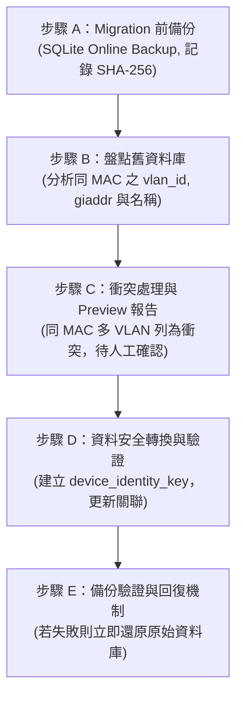

# DHCP Analyzer 資料庫與效能優化系統開發規格書

**文件版本：** V2.3 (System Architecture & Operations Edition)  
**系統名稱：** DHCP Packet & Log Analyzer  
**執行平台：** Windows 11 64-bit  
**開發語言：** Python 3.10+ (原生 venv 環境)  
**核心框架：** FastAPI、SQLite 3 (WAL Mode)、Scapy + Npcap  
**升級原則：** 以既有 V2.2 為基礎漸進式升級，保留已完成的功能、測試契約與資料庫 Migration，不重寫既有 DHCP Parser。

---

# 第一章、專案目標與核心設計原則

## 1.1 專案目標與功能範圍

建置適用於校園及企業內部網路的 DHCP 封包與日誌分析工具，整合離線大量資料分析與背景即時監控，核心功能包含：

1. **DHCP 封包解析與事件串流紀錄**：支援 DISCOVER、OFFER、REQUEST、DECLINE、ACK、NAK、RELEASE、INFORM 完整訊息類型。
2. **多源離線分析**：支援 PCAP、PCAPNG 及 CSV 檔案串流分析，單次分析超過 1,000,000 筆事件時，不得整檔載入記憶體。
3. **背景常駐即時監控**：獨立背景程序透過 Scapy + Npcap 擷取實體網卡 UDP 67/68 封包，採 Events Only 模式，不錄製完整即時 PCAP。
4. **網路異常偵測引擎**：自動即時識別 Rogue DHCP Server、DHCP Flooding/Starvation、IP Conflict 及異常租約（Abnormal Lease Time）。
5. **設備長期識別與資產清冊**：將 MAC、IP、Hostname、DHCP Server 及 Relay 網段關聯，並提供人工維護設備名稱與擺放位置。
6. **Web 查詢與管理儀表板**：提供秒級時間窗查詢、除錯 CSV 串流匯出、離線分析工作佇列提交與監控健康燈號。
7. **可設定的獨立資料保存與自動維運**：Events 預設 30 天清理，設備主檔與統計長期保存，每日凌晨 03:00 自動執行 5GB 磁碟預檢、WAL Checkpoint 與線上熱備份。

## 1.2 V2.3 核心架構決策矩陣

| 構面 / 項目 | V2.3 權威架構決策 | 決策依據與約束 |
| :--- | :--- | :--- |
| **資料庫核心** | 單一 SQLite 3，啟用 WAL Mode | 避免多庫分散與並行鎖定衝突；唯讀端點採獨立唯讀連線。 |
| **DHCP Parser** | 保留既有 Python 解析核心 | 嚴禁重寫；新增邏輯以 Normalizer / Adapter 形式擴充。 |
| **離線檔案來源** | 支援 PCAP、PCAPNG、CSV | 統一採用 Generator 串流分批讀取，記憶體用量受控。 |
| **即時監控模式** | 獨立背景程序，Events Only | 僅保存解析事件、異常與統計，**不錄製即時完整 PCAP**。 |
| **VLAN 支援策略** | **Relay Only 策略** | 不解析 802.1Q Dot1Q / QinQ 標籤，保留既有 `giaddr` 擷取與對照。 |
| **預設網路環境** | 無 VLAN 切割或視為 VLAN 1 | 未設定對照表時，所有未標記設備事件歸入預設 VLAN 1。 |
| **設備識別維度** | **MAC + VLAN 複合識別** | 識別公式：`Device Identity = Normalized MAC + VLAN ID`。 |
| **DB 寫入架構** | 單一 DB Writer 協調器 | 嚴格禁止 API、Worker 或 Monitor 直接寫入 SQLite。 |
| **寫入優先權隊列** | 即時監控 (HIGH) > 離線分析 (NORMAL) > 維運清理 (LOW) | 具備老化機制（Aging）防餓死，保障即時封包零遺漏。 |
| **Web 控制邊界** | **嚴格禁止 Web 啟停監控程序** | 網頁端點完全解耦，僅允許唯讀查詢與離線分析工作提交。 |

## 1.3 開發者必須遵守的不可破壞原則

1. **不重寫既有 DHCP Parser**：保留 `core/dhcp_parser.py` 解析核心與輸出契約（Option 12, 50, 51, 54, 81）。
2. **不破壞已完成的 V2.2 實作成果**：包括 Migration 1–7、單一 DB Writer、40 項通過之自動化測試。
3. **不覆蓋現有資料庫**：新版本升級必須採版本化 Migration 漸進遷移，嚴禁暴力刪庫或重建。
4. **不重複新增既有欄位**：`dhcp_events.vlan_id` 與 `relay_ip` 已存在，不得重複宣告。
5. **不將 `giaddr` 誤認為 VLAN ID**：`giaddr` 為 Relay Agent IP，唯有透過管理者明確設定之對照表方能歸入特定 VLAN。
6. **不將舊設備未經盤點直接合併**：舊設備資料遷移必須先備份、產生衝突報告，由管理者確認後轉換。
7. **不錄製即時完整 PCAP 檔案**：避免在長時間即時監控下造成伺服器硬碟瞬間寫滿。

---

# 第二章、系統整體架構與執行環境

## 2.1 四大獨立解耦運作軌道

本系統依據「完全解耦」與「短交易協調」原則，劃分為四大獨立運作軌道：

```text
 ┌────────────────────────────────────────────────────────────────────────┐
 │                         軌道一：即時封包監控軌道                        │
 │  run_live_monitor.ps1 ──> dhcp_monitor.py (Scapy+Npcap 網卡監聽)       │
 │                                │ (HIGH 優先權每 5 秒提交批次)           │
 │                                ▼                                       │
 │                         db_writer.py (WriterClient)                    │
 └────────────────────────────────┼───────────────────────────────────────┘
                                  │
 ┌────────────────────────────────┼───────────────────────────────────────┐
 │                                ▼                                       │
 │                         SQLite 3 資料庫 (WAL Mode)                     │
 │                         data/dhcp_analyzer.db                          │
 │                                ▲                                       │
 │  ┌─────────────────────────────┴─────────────────────────────────────┐ │
 │  │ 軌道二：Web 查詢與管理軌道                                         │ │
 │  │ run_web.ps1 ──> app.py (FastAPI http://127.0.0.1:8000)            │ │
 │  │                  (唯讀 SELECT Keyset Pagination 查詢；嚴禁控制監控)│ │
 │  └───────────────────────────────────────────────────────────────────┘ │
 └────────────────────────────────────────────────────────────────────────┘

 ┌────────────────────────────────────────────────────────────────────────┐
 │                         軌道三：離線分析工作者軌道                      │
 │  Web 使用者上傳 ──> UploadService (串流分段儲存、SHA-256、建立 Job)   │
 │                                │                                       │
 │                                ▼                                       │
 │                         workers/job_runner.py (背景線程 Worker)        │
 │                                │ (NORMAL 優先權串流批次寫入)           │
 │                                └──────────────► db_writer.py           │
 └────────────────────────────────────────────────────────────────────────┘

 ┌────────────────────────────────────────────────────────────────────────┐
 │                         軌道四：Windows 自動維運排程軌道                │
 │  register_task_scheduler.ps1 ──> Windows 工作排程器 (每日凌晨 03:00)   │
 │                                         │                              │
 │                                         ▼                              │
 │                                  run_maintenance.bat                   │
 │                                         │                              │
 │                                         ▼                              │
 │                                  maintenance.py                        │
 │      (1. 檢查磁碟剩餘 >= 5GB；2. 清理 30 天明細；3. WAL Checkpoint；   │
 │       4. SQLite Online Backup 熱備份至 backups/ 目錄)                  │
 └────────────────────────────────────────────────────────────────────────┘
```

## 2.2 程序責任矩陣

| 程序 / 模組 | 主要責任 | 可否直接寫入 SQLite？ |
| :--- | :--- | :---: |
| **DHCP Monitor (`dhcp_monitor.py`)** | 網卡封包擷取、呼叫 Parser、異常偵測、Console 彩色警示、雙寫 CSV | ❌ 否（交由 DB Writer） |
| **DHCP Parser (`core/dhcp_parser.py`)** | 封包解析、DHCP Options 提取、欄位正規化 | ❌ 否（純無狀態邏輯） |
| **Analysis Worker (`workers/`)** | PCAP/PCAPNG/CSV 巨量串流讀取、建立設備快照 | ❌ 否（交由 DB Writer） |
| **DB Writer (`db_writer.py`)** | 單一交易協調器、優先權排程、批次 COMMIT、WAL 隔離 | **✅ 是（唯一合法寫入者）** |
| **FastAPI Backend (`app.py`, `api_v2.py`)** | 唯讀查詢 API、上傳接收、建立 Job、人工設備維護 | ❌ 否（更新設備交由 Writer） |
| **Maintenance Worker (`maintenance.py`)** | 5GB 磁碟預檢、30 天過期修剪、WAL Checkpoint、線上熱備份 | **✅ 是（維運排程專用寫入）** |
| **Web Frontend (`templates/`)** | 狀態燈號、秒級時間窗查詢、除錯 CSV 匯出、DOM 安全呈現 | ❌ 否（純瀏覽端） |

## 2.3 Windows 11 執行環境與驅動整合

| 項目 | 規格與設定 |
| :--- | :--- |
| **作業系統** | Windows 11 64-bit |
| **Python 環境** | 官方 Python 3.10+（採用標準 `python -m venv` 虛擬環境） |
| **封包驅動** | Npcap 1.70+（安裝時勾選 *WinPcap API-compatible Mode*） |
| **封包過濾 (BPF)** | `filter="udp and (port 67 or port 68)"`，搭配 `store=False` 防止記憶體累積 |
| **中文網卡解析** | 內建 `resolve_windows_interface`，自動將「`乙太網路 2`」轉換為 `\Device\NPF_{GUID}` |
| **磁碟保護門檻** | 內建 5GB 預檢防護，剩餘空間不足 5,120 MB 時主動終止，保護 SQLite 資料庫安全 |

## 2.4 建議專案程式目錄結構

```text
Monitor/
├── app.py                      # FastAPI Web 主程式，掛載前端路由與 API
├── api_v2.py                   # V2 RESTful API 端點（查詢、上傳、時間窗匯出、設備維護）
├── dhcp_monitor.py             # Scapy + Npcap 背景即時封包監控程序（含彩色 Console 與 CSV 雙寫）
├── db_writer.py                # 單一 SQLite 寫入協調器（HIGH/NORMAL/LOW 優先權、短交易、重試）
├── maintenance.py              # 資料庫維護（30 天清理、WAL Checkpoint、Online Backup、5GB 預檢）
├── retention_worker.py         # 資料保留獨立作業程式
├── config.yaml                 # 系統設定檔（門檻、路徑、隊列上限、對照表）
├── requirements.txt            # Python 標準相依套件清單
├── pyproject.toml              # 專案組態設定與測試定義
│
├── run_live_monitor.ps1        # 【即時監控啟動工具】自動解析中文網卡、5GB 磁碟預檢、CSV 雙寫
├── run_web.ps1                 # 【Web 服務啟動工具】啟動 http://127.0.0.1:8000、解耦原則指引
├── register_task_scheduler.ps1 # 【Windows 排程註冊工具】每日凌晨 03:00 自動維運一鍵註冊/移除
├── run_maintenance.bat         # 【維運批次檔】供 Windows Task Scheduler 排程執行維護
├── rebuild_project.bat         # 【環境重建與暫存清理工具】支援純清快取與完整重置雙模式
│
├── core/                       # 核心共用元件模組
│   ├── anomaly_engine.py       # 共用異常偵測引擎（Flooding、IP Conflict、Abnormal Lease、Rogue）
│   ├── config.py               # YAML 設定檔載入與型別校驗器
│   ├── dhcp_fields.py          # DHCP 欄位提取與 Hostname / FQDN 解碼
│   ├── dhcp_parser.py          # 共用 Scapy 封包解析器
│   ├── logger.py               # 系統統一日誌工具
│   └── models.py               # 標準化 DhcpEvent、WriteBatch 等共用資料模型
│
├── database/                   # 資料庫與 Migration 模組
│   ├── connection.py           # SQLite 連線管理（WAL、BUSY TIMEOUT、PRAGMA 優化）
│   ├── migrations.py           # Schema Migration 1–7 循序遷移器
│   └── repositories.py         # 資料庫存取層（Jobs, Events, Devices, System Status）
│
├── services/                   # 業務邏輯服務層
│   └── upload_service.py       # 安全檔案串流上傳、Magic Bytes 檢驗、SHA-256 計算
│
├── workers/                    # 背景分析工作者模組
│   ├── csv_worker.py           # 巨量 CSV 逐列串流分析 Worker
│   ├── pcap_worker.py          # PCAP / PCAPNG 封包逐筆串流分析 Worker
│   └── job_runner.py           # 離線分析佇列執行與進度回報
│
├── templates/                  # 前端 HTML 樣板
│   ├── index.html              # 主儀表板（監控心跳、離線分析、時間窗查詢、CSV 匯出）
│   └── device_mapping.html     # MAC 對照電腦名稱清冊（含人工設備名稱與位置編輯 Modal）
│
├── static/                     # 靜態資源（Favicon 等）
├── data/                       # 實體資料庫目錄（dhcp_analyzer.db，列入 .gitignore）
├── upload/                     # 檔案上傳暫存目錄（incoming / stored，列入 .gitignore）
├── backups/                    # 資料庫線上備份存放目錄（列入 .gitignore）
└── tests/                      # 自動化測試套件（40 項單元與整合測試全數通過）
```

---

# 第三章、封包解析、事件模型與靜音引擎

## 3.1 核心 Parser 契約保留原則

`core/dhcp_parser.py` 為系統不可替換的解析核心，所有離線分析與即時監控必須共用相同的解析邏輯。

至少保留以下 DHCP Option 契約：
- **Option 12**：Client Hostname（支援 UTF-8 / Big5 / CP950 多重編碼容錯解碼）。
- **Option 50**：Requested IP Address。
- **Option 51**：IP Address Lease Time。
- **Option 54**：Server Identifier。
- **Option 81**：Client FQDN。
- 基礎欄位：Message Type、Client MAC（標準正規化為 `AA:BB:CC:11:22:33`）、Server IP/MAC、Assigned IP (`yiaddr`)、Relay IP (`giaddr`)、Transaction ID (`xid`)。

## 3.2 標準化事件模型 (`DhcpEvent`)

```python
class DhcpEvent(BaseModel):
    job_id: str
    event_time: str
    message_type: str
    client_mac: str
    source_type: str = "scapy"
    source_ip: str | None = None
    source_mac: str | None = None
    server_ip: str | None = None
    server_mac: str | None = None
    requested_ip: str | None = None
    assigned_ip: str | None = None
    hostname: str | None = None
    lease_time: int | None = None
    transaction_id: int | None = None
    relay_ip: str | None = None          # giaddr 實體值
    vlan_id: int | None = None           # 對應之 VLAN ID (預設 1 或對照表取得)
    vlan_source: str = "unknown"         # relay_mapping / configured_default / unknown
    device_identity_key: str | None = None # MAC|VLAN:ID 複合鍵
    is_rogue: bool = False
    anomaly_type: str | None = None
    severity: str | None = None
    source_packet_no: int | None = None
```

## 3.3 靜音封包精簡模式與 5 秒累計統計快照

為減輕百萬級流量下 SQLite 寫入負載，系統預設啟用靜音精簡模式：

1. **必須逐筆寫入的關鍵事件**：
   - 包含 NAK、DECLINE。
   - 未授權 Rogue DHCP OFFER / ACK。
   - 觸發異常偵測門檻之事件（Flooding、IP 衝突、異常租約）。
   - 新發現的 MAC 設備或新 IP 租約建立。
2. **可被靜音精簡的常規事件**：
   - 已知設備之重複 REQUEST、INFORM、ACK 事件，僅計入統計快照，不逐筆插入 `dhcp_events`。
3. **5 秒累計快照冪等性**：
   - 每 5 秒提交累計快照（`discover_count`、`request_count`、`ack_count`、`silent_filtered_count` 等），採覆蓋更新，保證重試時數據不重複累加。

---

# 第四章、單一資料庫寫入協調架構 (DB Writer)

## 4.1 單一寫入入口與短交易原則

SQLite 於 WAL 模式下支援「多讀單寫」。為徹底杜絕 `database is locked` 錯誤，所有寫入行為必須經過 `db_writer.py`：

```python
PRAGMA journal_mode = WAL;
PRAGMA synchronous = NORMAL;
PRAGMA foreign_keys = ON;
PRAGMA busy_timeout = 10000;  -- 10 秒忙碌等待
PRAGMA cache_size = -32768;    -- 32 MB 記憶體分頁快取
```

## 4.2 三級優先權調度隊列與防餓死機制 (Aging)

DB Writer 內部維護三組優先權隊列：

| 優先權 | 工作項目 | 調度特性與防護 |
| :--- | :--- | :--- |
| **HIGH** | 即時監控事件、告警與心跳 | 最高優先處理，延遲最小化，保證監控不中斷。 |
| **NORMAL** | 離線檔案分析批次與統計 | 串流分批寫入，不阻塞即時監控。 |
| **LOW** | 自動維運 30 天資料清理 | 離峰維護，低優先權短交易提交。 |

- **防餓死老化機制（Aging Algorithm）**：若 NORMAL 或 LOW 隊列中的批次等待超過門檻（例如 10 秒），自動暫時提升優先權，避免離線分析或清理工作永久飢餓。

## 4.3 批次提交、COMMIT ACK 與隊列背壓 (Backpressure)

1. **雙觸發批次提交**：累積達 1,000 筆或距上次提交達 5 秒，任一條件成立即觸發交易寫入。
2. **COMMIT ACK 機制**：DB Writer 必須在 SQLite `COMMIT` 成功後才向調用者回報成功；若遭遇 Lock 則依指數退避重試（最多 5 次），超過重試上限則回報失敗並記錄日誌。
3. **隊列背壓（Queue Backpressure）**：各隊列設定容量上限（例如 50,000 筆）。當隊列飽和時，主動降低上游讀取 Worker 速率，嚴禁記憶體無限制膨脹或靜默丟棄封包。

---

# 第五章、即時監控與離線分析工作者

## 5.1 即時監控模組 (`dhcp_monitor.py`)

- **非同步封包嗅探**：使用 Scapy `AsyncSniffer` 綁定指定實體網卡，維持 `store=False`。
- **雙寫輸出架構**：
  - 彩色控制台（Console）：即時列印封包類型、MAC、IP 與異常醒目提示。
  - 本機 CSV 備援：同步將封包寫入本機 `dhcp_events.csv`，提供本機第二重保障。
- **優雅停機（Graceful Shutdown）**：攔截 `Ctrl+C`（SIGINT），先停止接收封包，隨後強制執行緩衝區 Flush，將未提交事件與最後統計快照寫入資料庫，並將 Job 狀態標記為 `completed` 後安全退出。

## 5.2 巨量離線分析工作者 (`workers/`)

支援 PCAP、PCAPNG 與 CSV 三種格式，單次分析百萬筆事件時恪守「串流不爆記憶體」原則：

```mermaid
flowchart LR
    Upload["使用者上傳<br>(PCAP/PCAPNG/CSV)"] --> StreamSave["UploadService 串流寫入<br>(計算 SHA-256, 檔案隔離)"]
    StreamSave --> CreateJob["建立 Job 記錄<br>(狀態: queued)"]
    CreateJob --> WorkerThread["JobRunner 背景線程啟動"]
    WorkerThread --> StreamParse["Worker 串流分段讀取<br>(LIMIT 1000 筆/批次)"]
    StreamParse --> SubmitWriter["以 NORMAL 優先權<br>提交 DB Writer"]
    SubmitWriter --> UpdateProgress["更新 Job 進度 %<br>與統計快照"]
    UpdateProgress --> Completed["Job 狀態更新為 completed"]
```



---

# 第六章、異常偵測與安全性引擎

共用異常偵測引擎（`core/anomaly_engine.py`）同時為即時監控與離線分析提供一致的檢驗標準：

| 異常類型 | 初始判定門檻 | 處理動作與狀態標記 |
| :--- | :--- | :--- |
| **Client Flooding** | 單一 MAC 10 秒內超過 20 次 DISCOVER / REQUEST | 標記為 `confirmed`，記錄告警次數並限制寫入。 |
| **Random MAC Flooding** | 1 秒內超過 100 次不同 MAC 發送請求（Starvation 攻擊） | 觸發緊急背壓防護，保護 SQLite 記憶體。 |
| **IP Conflict** | 60 秒內觀察到不同 MAC 取得相同 IP | 先標記為 `suspected`，結合租約與封包比對後確認。 |
| **Abnormal Lease** | 租約時間 < 300 秒 或 > 2,592,000 秒（30天） | 標記為異常租約事件並記錄原始 Options。 |
| **Rogue DHCP** | 非授權 DHCP Server IP 發出 OFFER / ACK | **最高等級告警**，立即標記 `is_rogue = 1` 並顯示紅色粗體。 |

---

# 第七章、Web 後端 API 與前端呈現架構

## 7.1 FastAPI 唯讀查詢與架構解耦原則

- **嚴格解耦原則**：Web 介面**嚴禁提供任何啟動、停止或重啟監控程序之端點**。監控程序的生命週期完全由主機管理員透過命令列掌控。
- **Keyset Pagination 後端分頁**：單次查詢預設 100 筆，上限 500 筆，禁止一次性回傳大量資料灌爆前端 DOM。
- **短交易設備維護端點**：提供 `PATCH /api/v2/devices/{mac}` 允許管理員人工維護特定 MAC 的電腦名稱（`device_name`）與擺放位置（`location`），採短交易完成，零阻塞監控。
- **除錯 CSV 串流匯出**：提供帶有 `relay_ip`、`transaction_id` 與完整 Options 的串流下載端點，供外部網路工程師進行離線除錯。

## 7.2 前端介面與 DOM 安全規範

1. **健康輪詢與心跳容錯**：前端每 4 秒輪詢狀態，監控心跳若超過 15 秒未更新則顯示黃色警告，超過 25 秒並重試 2 次後才標記 Offline，杜絕短暫瞬斷之誤報。
2. **DOM 安全渲染**：所有來自網路封包的文字欄位（Hostname、FQDN、Option 內容）均視為不可信輸入，**一律使用 `textContent` 或安全元件渲染**，嚴禁使用 `innerHTML` 字串拼接，杜絕 XSS 弱點。
3. **自動捲動 Focus 導引**：離線分析完成後，前端自動平滑捲動（Smooth Scroll）至成果圖表區塊，提升操作體驗。

---

# 第八章、VLAN 環境支援與設備識別開發架構

本章為專案 V2.3 之核心升級規範，明確定義 Relay Only 策略、複合設備識別、以及舊資料庫安全遷移流程。

## 8.1 V2.3 VLAN 範疇：Relay Only 策略

經過深度架構評估，V2.3 確立採行 **Relay Only 策略**：

- **保留並活用既有 `giaddr`**：完整解析、儲存、查詢與匯出 DHCP Relay Agent IP。
- **不新增 802.1Q Dot1Q / QinQ 封包解析**：不要求從 SPAN Trunk 鏡像取得實體 VLAN Tag，杜絕 Windows 驅動層剝除標籤（VLAN Strip）導致之不可靠問題。
- **嚴禁數值推測**：`giaddr` 為 Relay 路由器 IP，非 VLAN ID。嚴禁以 IP 最後一碼或網段自動猜測 VLAN ID。

## 8.2 預設網路環境與 Relay-to-VLAN 對照機制

```yaml
network:
  default_vlan_id: 1             # 預設單一 VLAN 環境
  vlan_detection:
    mode: relay                  # 採用 Relay 對照模式
  relay_vlan_mapping:            # 管理者明確驗證之對照表
    "192.168.10.1": 10
    "192.168.20.1": 20
```

### VLAN 判定優先順序：
1. **第一優先**：事件具備 `giaddr` 且命中 `relay_vlan_mapping` ➜ 採用對照表 VLAN（`vlan_source: relay_mapping`）。
2. **第二優先**：未命中對照表且啟用單一 VLAN 預設 ➜ 採用 `default_vlan_id: 1`（`vlan_source: configured_default`）。
3. **第三優先**：管理者關閉預設且無對照 ➜ 標記為 `UNKNOWN`。

## 8.3 設備識別：MAC + VLAN 複合鍵

為解決跨網段移動或多 VLAN 共享同一 MAC 之定位問題，設備識別正式升級為：

$$	ext{Device Identity} = 	ext{Normalized MAC Address} + 	ext{VLAN ID}$$

- **唯一性約束**：在資料庫建立 `device_identity_key`（例如 `AA:BB:CC:11:22:33|VLAN:1`、`AA:BB:CC:11:22:33|VLAN:20`），克服 SQLite 對 NULL 值之特殊處理。
- **獨立追蹤**：相同 MAC 出現在不同 VLAN 時，視為不同的網路實體紀錄，**嚴禁跨 VLAN 暴力合併**。

## 8.4 舊設備資料安全 Migration 8 規範

> [!IMPORTANT]
> **舊資料庫升級 Migration 8 是不可跳過的安全關卡，絕對禁止未經盤點直接執行批次覆寫！**

遷移流程必須嚴格依循五大步驟：



1. **步驟 A：前置一致性備份**：停止寫入程序，使用 SQLite Online Backup API 產出熱備份至 `backups/`，記錄檔案大小與 SHA-256。
2. **步驟 B：盤點舊資料**：檢驗既有 `devices` 與 `dhcp_events`，統計同 MAC 的 `giaddr` 分布、IP 網段與人工維護欄位。
3. **步驟 C：衝突處理與 Preview 報告**：
   - MAC 唯一且無衝突 ➜ 自動轉為 VLAN 1。
   - 同 MAC 出現不同 VLAN ➜ **列入衝突報告，禁止自動合併**，待網管審查。
4. **步驟 D：資料轉換與完整性檢查**：建立 `device_identity_key` UNIQUE 約束，更新 `job_device_mappings`，驗證零孤兒外鍵。
5. **步驟 E：回復機制**：若轉換中拋錯，自動停止升級並以備份資料庫百分之百還原。

---

# 第九章、系統維運、自動排程與部署 Runbook

本章為專案之獨立維運大專章，提供系統管理員從「部署安裝」到「日常自動維運」之標準作業程序（Runbook）。

## 9.1 獨立資料保留政策 (Independent Retention)

系統拒絕一刀切的清理機制，採用分層獨立保存策略：

| 資料類別 | 保存天數 / 政策 | 執行機制與頻率 |
| :--- | :--- | :--- |
| **`dhcp_events` (事件明細)** | 預設保存 30 天 | 每日凌晨 03:00 以 `LIMIT 5000` 短交易分批修剪。 |
| **`devices` (設備主檔)** | **長期保留** | 不受 30 天限制，保留完整資產與人工備註。 |
| **`analysis_jobs` & `stats`** | 長期保留 | 保留歷史分析進度與統計趨勢。 |
| **原始上傳檔案 (`upload/stored`)** | 設定檔獨立控制 | 依 `raw_file_retention_days` 政策清理。 |

## 9.2 每日 03:00 自動維運三部曲與排程註冊

透過 [`register_task_scheduler.ps1`](file:///D:/agy-chengyan/Monitor/register_task_scheduler.ps1) 向 Windows 工作排程器註冊每日凌晨 03:00 執行 [`maintenance.py`](file:///D:/agy-chengyan/Monitor/maintenance.py)：

1. **第一部曲：5GB 磁碟空間安全預檢**：剩餘空間小於 5,120 MB 時主動發出警報並終止，防止磁碟寫滿損壞 SQLite。
2. **第二部曲：分批修剪 30 天過期事件**：分批執行短交易 DELETE，不長時間鎖定資料庫，保障即時監控寫入。
3. **第三部曲：WAL Checkpoint 與線上熱備份**：
   - 執行 `PRAGMA wal_checkpoint(TRUNCATE)` 釋放 WAL 磁碟分區。
   - 調用 SQLite Online Backup API 產出熱備份至 `backups/dhcp_analyzer_backup_YYYYMMDD_HHMMSS.db`。

## 9.3 專案暫存清理與環境重建規格 (`rebuild_project.bat`)

提供標準化批次維運工具 [`rebuild_project.bat`](file:///D:/agy-chengyan/Monitor/rebuild_project.bat)，支援雙模式：

- **模式 1：純暫存清理（保留資料庫）**：
  ```cmd
  rebuild_project.bat --clean-cache
  ```
  清空 `__pycache__`、`*.pyc`、`.pytest_cache`、`tests/.tmp`、以及 `upload/` 佇列（保留資料夾結構），安全保留 `data/dhcp_analyzer.db`。
- **模式 2：完整重置（Full Rebuild）**：
  ```cmd
  rebuild_project.bat --full -y
  ```
  清空所有快取、重置 SQLite 資料庫、刪除舊環境殘留、並自動重新同步環境。

## 9.4 現場部署標準作業程序 (Step-by-Step SOP)

1. **步驟一：建立乾淨虛擬環境**
   ```powershell
   python -m venv .venv
   .\.venv\Scripts\Activate.ps1
   python -m pip install --upgrade pip
   pip install -r requirements.txt
   pytest  # 必須 40 項全數通過
   ```
2. **步驟二：啟動即時監控背景程序（軌道一）**
   ```powershell
   .\run_live_monitor.ps1  # 自動 5GB 預檢、中文網卡解析、雙寫 CSV
   ```
3. **步驟三：啟動 Web 查詢儀表板（軌道二）**
   ```powershell
   .\run_web.ps1  # 服務啟動於 http://127.0.0.1:8000
   ```
4. **步驟四：註冊自動維運排程（軌道四）**
   ```powershell
   .\register_task_scheduler.ps1  # 以系統管理員身分執行
   ```

## 9.5 上線當日健康驗收與異常排查 SOP

- **驗收指標**：監控心跳綠色 Active（5–25 秒）、封包計數隨租約活動遞增、時間窗秒級查詢、除錯 CSV 串流匯出包含 `relay_ip`、人工設備備註重新整理後完整保存。
- **異常排查 SOP**：
  - **磁碟不足 5GB 警報**：執行 `rebuild_project.bat --clean-cache` 釋放空間。
  - **封包計數為 0**：檢查 `Get-Service npcap` 服務狀態與交換器 SPAN 鏡像連接埠。
  - **Web 介面 HTTP 503 暫態鎖定**：系統短交易自保機制，前端 2 秒後自動重試恢復。

## 9.6 系統整合設定檔規格 (`config.yaml`)

```yaml
database:
  path: "data/dhcp_analyzer.db"
  batch_size: 1000
  flush_interval_seconds: 5
  busy_timeout_ms: 10000

network:
  default_vlan_id: 1
  vlan_detection:
    mode: relay
  relay_vlan_mapping: {}

monitor:
  interface: "乙太網路 2"
  heartbeat_interval_seconds: 5
  heartbeat_timeout_seconds: 15
  live_capture_mode: events
  min_disk_free_mb: 5120

retention:
  cleanup_time: "03:00"
  dhcp_events:
    enabled: true
    days: 30
  devices:
    enabled: false  # 長期保留

anomaly_detection:
  client_flood:
    enabled: true
    window_seconds: 10
    threshold: 20
  random_mac_flood:
    enabled: true
    window_seconds: 1
    threshold: 100
  ip_conflict:
    enabled: true
    window_seconds: 60
  lease_time:
    min_seconds: 300
    max_seconds: 2592000
```

---

# 第十章、測試驗收、分階段開發計畫與 Handover

## 10.1 自動化測試驗收標準

全案必須維持全套自動化測試 100% 通過（目前基準為 40 passed）：

1. **Parser 相容性**：Option 12、50、51、54、81 提取精確，`giaddr` 既有邏輯不變。
2. **DB Writer 優先權防護**：驗證 HIGH/NORMAL/LOW 排程、Aging 防餓死、SQLite Lock 重試。
3. **百萬級巨量串流測試**：114,608 筆巨量 CSV 串流分析通過，記憶體維持穩定不暴增。
4. **後端分頁與 DOM 安全**：28,237 筆 NAK 數據分頁受限於 500 筆內，無大量渲染延遲。
5. **多行程並行壓力**：即時監控（HIGH）、離線 Worker（NORMAL）與 Web API 同時高頻並行下數據零遺漏。

## 10.2 V2.3 分階段開發交付順序 (Phase 0 ～ 7)

```text
Phase 0：既有系統盤點 ──> Phase 1：設備識別與 Relay VLAN ──> Phase 2：DB Writer 強化
                                                                       │
Phase 5：FastAPI 後端 <── Phase 4：離線分析與檔案管理 <── Phase 3：即時監控與靜音統計
       │
       ▼
Phase 6：Frontend 介面 ──> Phase 7：整體壓力與正式驗收 (百萬筆分析、災難復原演練)
```

## 10.3 目前已完成之 21 項實作資產清冊

1. Schema Migration 1–7 循序遷移器。
2. SQLite WAL 模式與唯讀連線保護機制。
3. 單一 DB Writer 優先權調度隊列與防餓死機制。
4. 共用 DHCP Parser 與標準化 `DhcpEvent` 契約。
5. PCAP / PCAPNG / CSV 巨量串流讀取 Worker。
6. 即時監控程序每 5 秒持久化與 CSV 雙寫輸出。
7. Windows 中文網卡名稱與 GUID 智慧解析器。
8. 啟動前 5GB 磁碟空間門檻預檢防護。
9. 異常偵測引擎（Flooding、IP Conflict、Abnormal Lease、Rogue）。
10. Web 查詢與管理端點嚴格解耦。
11. 方法三時間窗查詢（5m、30m、1h、1d、自訂區間）。
12. 工程師除錯 CSV 串流匯出（完整包含 `relay_ip`）。
13. 人工設備名稱與位置維護 API（Migration 7 + 短交易）。
14. 前端 25 秒輪詢心跳搭配 2 次重試防誤報。
15. Windows 工作排程器一鍵註冊工具 (`register_task_scheduler.ps1`)。
16. 自動維運三部曲（5GB 預檢、30 天修剪、WAL Checkpoint、線上熱備份）。
17. 專案暫存清理工具 (`rebuild_project.bat`) 支援雙模式。
18. 多行程跨程序高並行壓力驗證通過。
19. PCAPNG 串流解析驗證通過。
20. 114,608 筆巨量 CSV 與 28,237 筆 NAK 分頁驗證通過。
21. 全套 40 項自動化單元與整合測試全數通過（40 passed in ~100s）。

## 10.4 接續開發第一優先工作 (Next Step: Phase 0)

依據 V2.3 規範，下一階段接續人員**嚴禁直接執行批次寫入或暴力合併舊設備**，首要任務為執行 **Phase 0：既有系統盤點**：
1. **建立資料庫前置一致性熱備份**：記錄備份時間、檔案大小與 SHA-256。
2. **舊資料庫盤點分析**：撰寫唯讀盤點腳本，分析現有 `devices` 與 `dhcp_events` 中同 MAC 的 `vlan_id`、`giaddr`、IP 網段分布與人工名稱。
3. **產出 Migration 8 Preview 與衝突報告**：列出待確認設備清單供管理者審查後，方可推進至 Phase 1。
